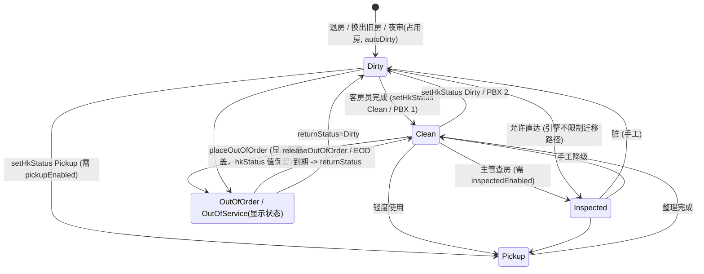
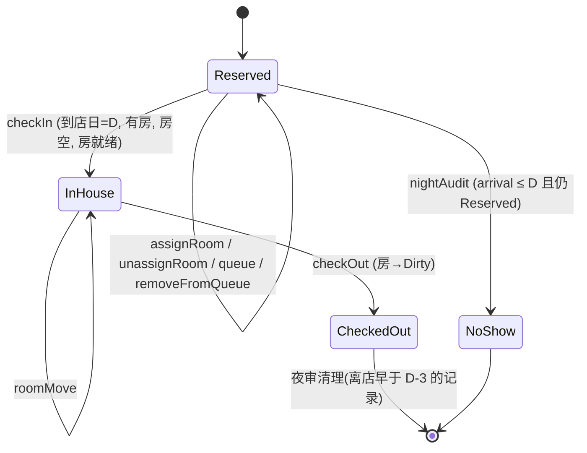
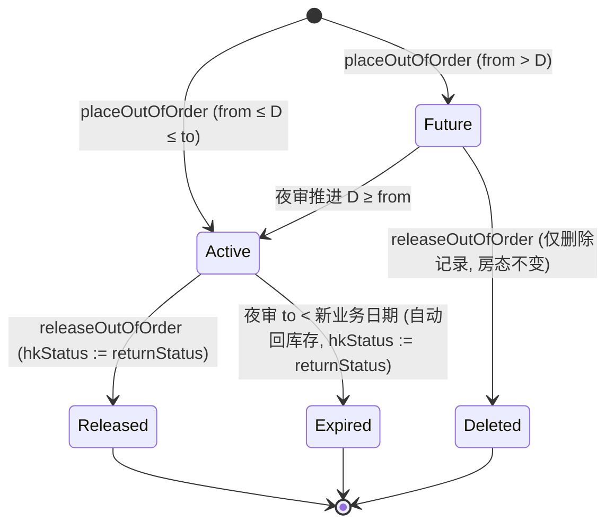

# WBS-2 功能设计说明书：OPERA Cloud 房态管理与房态同步 Demo

> 版本：v1.0 · 日期：2026-10-13 · 依据：`docs/01-research-opera-room-management.md`（以下简称"调研报告"）与已实现的领域引擎 `packages/core/src/*`（以下简称"引擎"）。
> 本文描述的行为**以引擎实现为准**；与调研结论不一致之处集中列在第 12 章"设计偏差与待确认"。
> 术语约定：UI 采用 OPERA 英文标签（Housekeeping Board、Set Room Status 等），提供 中/EN 切换；本文说明性文字为中文，英文标签保持原样。
> 证据等级沿用调研报告：A = OHIP OpenAPI 原文；B = Oracle 文档摘要；C = 推测/Demo 自定义。

---

## 1. 背景与范围

### 1.1 背景
学习型项目：在浏览器与 Node 两种运行形态下复刻 Oracle OPERA Cloud PMS 的**房态管理 (Room Status Management)** 与**房态同步 (Room Status Synchronization, 经 OHIP)**，使学习者能直观看到：一次房态变化如何在前台、客房、移动端之间实时联动，并通过业务事件 (Business Events) 同步到外部系统（客房 App、PBX、门锁、能耗、渠道库存），以及同步失败后的漂移 (drift) 与补偿。

### 1.2 范围
| 范围 | 内容 |
|---|---|
| **In scope** | HK 房态 (Clean/Dirty/Pickup/Inspected)、OOO/OOS、前台状态派生、房间预订状态派生、差异 (Skip/Sleep/Person)、服务状态 DND/MUR、Turndown、房间条件、任务单分配（按 credits）、排房/入住/退房/换房/排队、夜审（End of Day）、业务事件、5 个模拟下游订阅者、OHIP 风格 REST 入站façade、PBX 房态码、移动端客房员应用、仪表盘 Tile |
| **Out of scope** | 账务/收银 (Billing/Cashiering)，退房不做余额校验；预订创建全流程、费率与可用性引擎；真实 OAuth / WebSocket / GraphQL 订阅（用 SSE + 简化令牌模拟）；多物业；Room Maintenance 维修单、Hold 房、叫醒服务、真实短信 |

### 1.3 运行形态（固定架构，仅描述）
- npm workspaces monorepo：`packages/core`（纯 TS 引擎 `PmsEngine`，server 与浏览器共用）、`apps/server`（Node/Express）、`apps/web`（React + Vite + TS，hash router）。
- **Server 形态**：`POST /api/commands`（通用命令入口）、`GET /api/snapshot`、`GET /api/stream`（SSE 推送 `ChangeSet`）、`GET /api/events?sinceSeq=`（轮询）、OHIP 风格façade（`/oauth/v1`、`/hsk/v1`、`/fof/v1`、`/csh/v1`）。
- **Local backend 形态（GitHub Pages）**：同一引擎跑在浏览器内，状态持久化到 `localStorage`，多标签页通过 `BroadcastChannel` 同步（见 §10）。

---

## 2. 角色

| 角色（Header 切换） | 默认 actor 名 | 典型操作 | UI 权限（Demo 级，非引擎强制） |
|---|---|---|---|
| Front Desk Agent | `OC-FD1` | 排房、入住、退房、换房、排队、OOO 查询、仪表盘 | 可见 Front Desk、Inventory 只读；不可见 Integration 写操作 |
| HK Supervisor | `OC-HK1` | Housekeeping Board 批量改房态、Task Sheets、Discrepancies、OOO/OOS、Room Condition | Inventory 全部可写 |
| Room Attendant | 所选客房员名（如 `Li Na`） | `#/mobile`：我的房间、置 Clean/Pickup、观察 Occupied/Vacant、DND | 仅 `#/mobile` 与首页；来源 `MOBILE` |
| Integration Admin | `OC-INT` | Sync Monitor、API Console、End of Day、参数、Reset | Integration、Miscellaneous 全部可写 |

> 引擎对 actor 只记录 `{name, source}`，不做授权。角色权限由 UI 隐藏/禁用实现（见文档 03）。`ChangeSource` 取值：`OPERA_UI | MOBILE | OHIP_API | PBX | NIGHT_AUDIT | SYSTEM`。

---

## 3. 术语表

| 术语 | 英文/代码 | 说明 |
|---|---|---|
| 房务房态 | HK Status / Room Status | `Clean`(CL) `Dirty`(DI) `Pickup`(PU) `Inspected`(IP)。PU、IP 受参数开关控制 |
| 显示房态 | Display Status | HK 房态，或当日有效 OOO/OOS 时显示 `OutOfOrder`/`OutOfService` |
| 前台状态 | FO Status | `Vacant` / `Occupied`，由在住预订推导，不可手工改 |
| HK 占用观察 | HK Occupancy | 客房员报告 Vacant/Occupied（+人数），用于差异检测 |
| 房间预订状态 | Room Reservation Status | `Not Reserved / Arrival / Arrived / Stay Over / Due Out / Departed / Day Use` |
| 差异 | Discrepancy | `Skip`（FO 占用/HK 报空）、`Sleep`（FO 空/HK 报占）、`Person`（人数不符） |
| OOO | Out of Order | 不可售、从库存扣除 |
| OOS | Out of Service | 暂不可用但仍计库存 |
| 返回状态 | Return Status | OOO/OOS 结束时房间回到的 HK 状态 |
| 服务状态 | Guest Service Status | `DND` 请勿打扰 / `MUR` 请即打扫 / `null` |
| 夜床 | Turndown | `Not Required / Required / Completed`（OHIP 拼写 `Compeleted`） |
| 房间条件 | Room Condition | 如 SHW(样板房)、HLD(保留)；`blocksAssignment=true` 的条件禁止排房（对应 OHIP `NotAvailable`） |
| 排队 | Queue Room | 已到店但房未就绪的预订排队等房 |
| 业务日期 | Business Date | 仅夜审推进，与自然日无关 |
| 任务单 | Task Sheet | 一个客房员当日的房间清单与 credits（Demo 中由 `room.attendantId` 派生，无独立实体） |
| 订阅者 | Subscriber | 模拟的外部系统，订阅业务事件 |
| 镜像 | Mirror | 订阅者眼中的房间状态副本（最终一致） |
| 漂移 | Drift | 镜像 ≠ PMS 投影 (projection) 的键 |
| 命令 | Command | 引擎唯一写入口 `PmsEngine.exec(cmd, actor)` |

---

## 4. 领域模型

### 4.1 实体与字段

**Hotel**：`hotelId`(`DEMO1`，即 OHIP `x-hotelid`)、`name`、`chainCode`、`businessDate`(ISO)、`parameters: HotelParameters`。

**HotelParameters**（OPERA Controls 模拟，默认全 true）
| 字段 | 含义 |
|---|---|
| `inspectedStatusEnabled` | 启用 Inspected；关闭时禁止设为 Inspected，且 Clean 视为就绪 |
| `pickupStatusEnabled` | 启用 Pickup |
| `allowCheckInClean` | 启用 Inspected 时，是否仍允许入住 Clean 房 |
| `autoDirtyOnNightAudit` | 夜审把所有占用房置 Dirty |

**RoomType**：`code`(SK/ST/DK/JS/ES)、`name`、`credits`(10/10/12/16/20)、`maxOccupancy`。

**Room**（持久字段）：`id`(如 `0305`，4 位补零)、`number`(`305`)、`floor`、`roomType`、`features[]`、`hkStatus`、`outOfOrder: OutOfOrderRecord|null`（每房至多一条）、`hkOccupancy`(null=今日未观察)、`hkPersons`、`serviceStatus`、`turndown`、`conditionCode`、`attendantId`、`section`(A–D，按楼层：≤3→A，≤5→B，≤7→C，其余 D)、`lastStatusChange`、`lastChangedBy`。

**OutOfOrderRecord**：`id`、`type: OOO|OOS`、`from`/`to`(含，ISO)、`reasonCode`、`returnStatus: HkStatus`、`remarks?`。

**Reservation**：`id`(如 `R482926`)、`confirmationNo`、`guestName`、`vip`、`roomType`、`arrival`/`departure`、`adults`/`children`、`status: Reserved|InHouse|CheckedOut|Cancelled|NoShow`、`roomId|null`、`queue: {queuedAt, priority}|null`、`eta`、`specials[]`、`checkedInAt/checkedOutAt`。

**Attendant**：`id`(HK01–HK06)、`name`、`section|null`(HK05/HK06 为浮动)、`maxCredits`(140/120)。
**RoomCondition**：`code/description/blocksAssignment`（SHW、HLD 阻止排房；VIP、CHK 不阻止）。
**ReasonCode**（OOO 原因）：PLB、ELE、HVA、RNV、DEP、FUR。

**BusinessEvent**：`id`(`EVT-000123`)、`seq`(单调递增)、`eventName`、`module`(HOUSEKEEPING/FRONT_DESK/RESERVATION/INVENTORY/NIGHT_AUDIT)、`hotelId`、`businessDate`、`timestamp`、`actor`、`source`、`primaryKey`、`roomIds[]`、`details[{elementName, oldValue, newValue}]`、`summary`。
**Subscriber**：`id`、`name`、`kind`、`events[]`、`enabled`、`mirror: Record<string,string>`、`delivered/failed`、`lastDeliveryAt`、`failureRate(0..1)`。
**Delivery**：`id`、`subscriberId`、`eventId`、`eventName`、`status: DELIVERED|FAILED|RETRYING|PENDING`、`attempts`、`timestamp`、`latencyMs`。
**ApiLogEntry**：`id`、`timestamp`、`method`、`path`、`status`、`requestBody`、`responseBody`、`appKey`。
**Snapshot** = hotel + roomTypes + rooms + reservations + attendants + conditions + oooReasons + events(≤500，新→旧) + subscribers + deliveries(≤500) + apiLog(≤200) + `version`。
**ChangeSet**：增量 `{version, hotel?, rooms?, reservations?, attendants?, events?(旧→新), subscribers?, deliveries?, apiLog?, reset?}`；`reset` 存在时客户端整体替换（夜审、Reset Demo）。

### 4.2 派生字段与公式（`selectors.ts`）

设 `D` = 业务日期。`indexReservations` 按 roomId 建三张索引：
- `inHouse`：`status=InHouse`；
- `arrival`：`status=Reserved ∧ arrival=D`；
- `departed`：`status=CheckedOut ∧ departure=D`。

| 派生量 | 公式 |
|---|---|
| **oooActive** | `room.outOfOrder ≠ null ∧ from ≤ D ≤ to` |
| **displayStatus** | oooActive ? (`type=OOO`→`OutOfOrder`；`OOS`→`OutOfService`) : `hkStatus` |
| **foStatus** | 存在 `inHouse` 预订 ? `Occupied` : `Vacant` |
| **persons**（FO 人数） | inHouse ? `adults+children` : 0 |
| **resvStatus**（按优先顺序） | ① inHouse 且 `arrival=departure` → `Day Use`；② inHouse 且 `departure ≤ D` → `Due Out`；③ inHouse 且 `arrival = D` → `Arrived`；④ 其余 inHouse → `Stay Over`；⑤ 有 `arrival` 索引 → `Arrival`；⑥ 有 `departed` 索引 → `Departed`；⑦ `Not Reserved` |
| **discrepancies**（仅当 `hkOccupancy ≠ null`） | `Skip`：FO=Occupied ∧ HK=Vacant；`Sleep`：FO=Vacant ∧ HK=Occupied；`Person`：FO=Occupied ∧ HK=Occupied ∧ `hkPersons ≠ null` ∧ `hkPersons ≠ persons` |
| **queued** | `arrival` 索引的预订且其 `queue ≠ null`（即"已排房并排队"） |
| **credits** | 房型 credits（缺省 10） |
| **isRoomReady(room)** | oooActive → false；`Inspected` → true；`Clean` → `!inspectedStatusEnabled ∨ allowCheckInClean`；其余 false |

### 4.3 仪表盘口径

**Room Status Tile**（`roomStatusTile`）：对 `Inspected, Clean, Pickup, Dirty` 四种 HK 状态，**排除当日 OOO/OOS 房**后分别计：
- `occupied` = foStatus=Occupied；
- `assigned` = foStatus=Vacant ∧ 存在今日 `arrival` 预订（已排房未入住，含排队中的）；
- `vacant` = foStatus=Vacant ∧ 无今日 `arrival`（含今日已退房 Departed 的脏房）。

**Room Summary**（`roomSummary`）：
`physical = 房间总数`；`outOfOrder = displayStatus=OutOfOrder 数`；`outOfService = displayStatus=OutOfService 数`；`inventory = physical − outOfOrder`（OOS 不扣）；`occupied = foStatus=Occupied 数`；`vacant = physical − occupied`；`occupancyPct = occupied/inventory×100`（保留 1 位小数）；`arrivalsExpected` = 今日 `Reserved` 到店数；`arrivalsUnassigned` = 其中无房者；`departuresExpected` = `InHouse ∧ departure ≤ D`；`departed` = 今日 CheckedOut；`discrepancies` = 有至少一种差异的房间数。

**Queue Tile**：`queueReservations` = `queue≠null ∧ status=Reserved`，按 `priority` 升序、`queuedAt` 升序。等待分钟 `minutesSince(queuedAt)`；平均等待 = 队列等待分钟的算术平均（UI 计算）；"房间就绪"= 所分配房 `isRoomReady`。

> 参考种子（`createInitialState`，PRNG 种子固定，房号对任意业务日期一致，业务日期=今日）：physical 96，OOO 1(703)，OOS 1(810)，inventory 95，occupied 51，Occupancy 53.7%；今日到店 22（10 未排房）；离店待办 17；已退房 9；差异 3：211 Sleep、511 Skip、711 Person；队列 2：R483035(205, Dirty)、R483050(408, Dirty)；SHW 样板房 212；DND：404/505/906/907，MUR：302/305。Room Status Tile 种子值：Inspected 1/6/12，Clean 8/3/8，Pickup 0/0/0，Dirty 42/3/11（occupied/assigned/vacant）。验收时以实际运行为准，种子变更则同步修订。

---

## 5. 状态机

### 5.1 HK 房态转换



规则要点：
1. **引擎不限制 HK 状态之间的迁移路径**（任一 → 任一），仅校验：参数开关（Inspected/Pickup）、房间当日处于 OOO/OOS（拒绝修改）。
2. OOO/OOS 是**叠加在 `hkStatus` 之上的显示层**，`room.hkStatus` 保持原值，期间不可改房态；解除时若记录当日有效，`hkStatus := returnStatus`。
3. 退房、换房（旧房）强制置 `Dirty`；夜审对占用房置 `Dirty`（若 `autoDirtyOnNightAudit`）。
4. 状态变为 `Clean/Inspected` 且房间就绪时，若有分配到该房的排队预订 → 触发 `QUEUE ROOM READY`。

### 5.2 预订生命周期


排队子状态：`Reserved` 且 `queue≠null` = "In Queue"；入住、取消排房、夜审 No Show 均清除 `queue`。

### 5.3 OOO/OOS 生命周期


OOO 与 OOS 共用同一记录结构，区别在于：OOO 从库存扣除并校验预订冲突，OOS 不扣库存，仅警告。

---

## 6. 命令业务规则

通用约定：
- 所有写操作经 `PmsEngine.exec(cmd, actor)`；**每个命令原子**：任一错误则整体回滚（引擎以 `structuredClone` 备份恢复），不产生事件。
- 结果 `CommandResult {ok, error?, errorCode?, warnings[], message?, changes}`；`ok=true` 且 `changes=null` 表示无变化。
- 校验失败未指定 code 时 `errorCode = VALIDATION`。
- 事件在命令成功后统一投递给订阅者（§8），`version++`。
- `roomIds` 参数可传 `id`(`0305`) 或 `number`(`305`)；预订参数可传 `id` 或 `confirmationNo`。

### 6.1 错误码总表

| errorCode | 含义 | 建议 HTTP（façade） | UI 处理 |
|---|---|---|---|
| `VALIDATION` | 通用校验失败（缺参、日期倒置、原因码无效…） | 400 | 表单内联红字 + Toast(error) |
| `NOT_FOUND` | 房间/预订不存在 | 404 | Toast |
| `PARAM` | 参数开关未启用（Inspected/Pickup） | 400 | Toast，提示去 End of Day 页参数 |
| `ROOM_OOO` | 房间 OOO/OOS 中，禁止修改房态/排房/换房 | 409 | Toast；提示"先 Return to Service" |
| `ROOM_OCCUPIED` | 房间被在住客人占用（OOO 放置/入住） | 409 | Toast；提示换房 |
| `ROOM_ASSIGNED` | 房间已分配给预订（放 OOO） | 409 | Toast；提示先取消排房 |
| `ALREADY_OOO` | 该房已有 OOO/OOS 记录 | 409 | Toast；提示先删除旧记录 |
| `ROOM_TYPE_MISMATCH` | 房型与预订不符 | 409 | **确认对话框 → 带 `force` 重发（升级/变更房型）** |
| `ROOM_CONDITION` | 房间条件 `blocksAssignment` | 409 | Toast |
| `ROOM_UNAVAILABLE` | 房间在该时段被其他预订占用 | 409 | Toast |
| `ROOM_NOT_READY` | 房间未就绪（非 Clean/Inspected 或 OOO） | 409 | **对话框：Add to Queue？** |
| `BAD_STATE` | 预订状态不允许该操作 | 409 | Toast |
| `NOT_ARRIVAL_DATE` | 非今日到店 | 409 | Toast |
| `NO_ROOM` | 入住前未排房 | 409 | 打开排房对话框 |
| `BAD_CODE` | PBX 房态码无效 | 400 | API Console 显示 |
| `DUE_OUTS_PENDING` | 夜审时仍有待离店在住客 | 409 | 对话框列出待办并跳转 In House |

### 6.2 房务命令

#### C1 `setHkStatus {roomIds[], status}`（Set Room Status）
| 项 | 规则 |
|---|---|
| 前置 | `roomIds` 非空（否则 VALIDATION）；`status=Inspected` 需 `inspectedStatusEnabled`（否则 `PARAM`）；`Pickup` 需 `pickupStatusEnabled`（`PARAM`）；房间存在（`NOT_FOUND`） |
| 逐房处理 | 房间当日 OOO/OOS 有效 → **跳过**并加 warning；否则若状态不同则更新 |
| 全部被跳过 | 抛 `ROOM_OOO`（无任何变化） |
| 效果 | `hkStatus := status`，`lastStatusChange/lastChangedBy` 更新；返回 message `"N room(s) set to X"` |
| 事件 | 每个**实际变化**的房间一条 `UPDATE ROOM STATUS`（`RoomStatus` old→new）；若变为 Clean/Inspected 且房就绪且有对应排队预订 → 另一条 `QUEUE ROOM READY` + warning "notify the guest" |
| 备注 | 状态相同则不产生事件（幂等） |

#### C2 `setHkOccupancy {roomId, occupancy, persons?}`（Housekeeping Status 观察）
| 前置 | 房间存在 |
|---|---|
| 效果 | `hkOccupancy := occupancy`；`hkPersons := Vacant→0；Occupied→max(1, persons ?? 原hkPersons ?? 1)` |
| 事件 | `UPDATE HOUSEKEEPING OCCUPANCY`（details: `HousekeepingStatus`, `HousekeepingPersons`） |
| 警告 | 计算后若出现差异 → warning "Room N: Skip/Sleep/Person discrepancy detected." |
| 备注 | 不改变 hkStatus；**始终产生事件**（即使值未变） |

#### C3 `resolveDiscrepancy {roomId}`（Resolve / Update to FO status）
| 前置 | 房间当前至少有一种差异，否则 VALIDATION "has no discrepancy" |
| 效果 | `hkOccupancy := foStatus`；`hkPersons := FO 人数` → 差异消失 |
| 事件 | `UPDATE HOUSEKEEPING OCCUPANCY`（oldValue=差异类型，newValue=`<FO> (resolved)`） |

#### C4 `setServiceStatus {roomIds[], service}`（DND/MUR/清除）
| 逐房 | 设置 DND/MUR 时房间必须**有在住客**，否则跳过+warning；清除(`null`)不受限；值相同则忽略 |
| 全跳过 | 若无任何更新且有 warning → VALIDATION（message=warnings 拼接） |
| 事件 | 每个变化房间 `GUEST SERVICE STATUS REQUEST`（`ServiceStatus` old→new） |

#### C5 `setTurndown {roomIds[], turndown}`
无附加校验；值不同才更新并发 `UPDATE TURNDOWN STATUS`。

#### C6 `setCondition {roomIds[], conditionCode|null}`
| 前置 | `conditionCode` 必须存在于 conditions（否则 VALIDATION "Unknown room condition"） |
| 警告 | 条件 `blocksAssignment` 且房间已分配给 `arrival ≥ D` 的 Reserved 预订 → warning（只阻止**新**排房，不撤销已有） |
| 事件 | `UPDATE ROOM CONDITION` |

#### C7 `placeOutOfOrder {roomIds[], oooType, from, to, reasonCode, returnStatus, remarks?}`（Place OOO/OOS）
| 项 | 规则（按引擎检查顺序） |
|---|---|
| 1 | `roomIds` 非空；`from ≤ to`（否则 VALIDATION "From date must be on or before To date"）；`from ≥ D`（"cannot be before the business date"） |
| 2 | `reasonCode` 须在原因表中（VALIDATION "A valid reason code is required"） |
| 3 | `returnStatus=Inspected` 须启用 Inspected（VALIDATION） |
| 4 | 逐房：已有记录 → `ALREADY_OOO`（消息含现有类型与日期） |
| 5 | **OOO**：时段内存在**在住**客人 → `ROOM_OCCUPIED`；存在**Reserved** 预订（已排该房且时段重叠）→ `ROOM_ASSIGNED`（消息含确认号） |
| 5' | **OOS**：有重叠预订仅 warning（"Out of Service keeps it sellable"），不阻止，**含在住客**（见偏差 D3） |
| 效果 | 写入 `outOfOrder{id:"OOO-<ts><roomNo>", …}`；`hkStatus` 不变 |
| 事件 | OOO → `NEW OUT OF ORDER`；OOS → `NEW OUT OF SERVICE`（details: `RoomStatus`(原hk → OutOfOrder/OutOfService)、`FromDate`、`ToDate`、`ReasonCode`） |
| 原子性 | 多房中任一失败则整体回滚（含已处理的房） |
| 库存影响 | 仅 `from ≤ D ≤ to` 时影响今日 Room Summary；未来记录不影响当日 |

#### C8 `releaseOutOfOrder {roomIds[]}`（Return to Service / 删除未来记录）
| 前置 | 房间有 OOO/OOS 记录，否则 VALIDATION |
| 效果 | 清除记录；**若记录当日有效**：事件之后 `setHk(returnStatus)`（hkStatus 不同则再发 `UPDATE ROOM STATUS`，且可能触发 QUEUE ROOM READY）；**若为未来记录**：仅删除，房态不变 |
| 事件 | OOO → `UPDATE OUT OF ORDER`；OOS → `UPDATE OUT OF SERVICE`（`RoomStatus` 旧→返回状态/当前状态） |

#### C9 `assignAttendant {roomIds[], attendantId|null}`
`attendantId` 须存在（VALIDATION "Unknown attendant"）；逐房变化发 `UPDATE ROOM ATTENDANT`。`null`=取消分配。

#### C10 `autoAssignTasks {attendantIds[], onlyDirty}`（Auto Generate Task Sheets）
| 前置 | 至少选一个存在的客房员 |
| 目标房 | 非当日 OOO/OOS；`onlyDirty=true`→ `Dirty/Pickup`；否则→ `hkStatus≠Inspected` 或 当前占用；按 `room.id` 升序处理 |
| 算法 | 对每房取 credits；候选 = `load+credits ≤ maxCredits` 的客房员；排序：**本区(section 相同)优先**，再按当前 load 升序；选第一个；无候选 → 记 unassigned，并清空该房原 attendantId |
| 效果 | 更新 `attendantId`；不在目标集内的房保持原分配；load 仅统计本次分配 |
| 事件 | **一条** `UPDATE ROOM ATTENDANT`（primaryKey=`TASKSHEET`，roomIds=本次实际变化的房，details=每位客房员 `"N credits"`） |
| 警告 | unassigned>0 → "N room(s) could not be assigned – attendant credit limits reached." |
| 与 OPERA 差异 | 无 stayover/departure 分单、无溢出单、无楼层差旅 credit（偏差 D9） |

#### C11 `pbxStatusCode {roomNumber, code}`（PBX 入站）
| 码 | 映射命令 |
|---|---|
| `1` | setHkStatus → Clean |
| `2` | setHkStatus → Dirty |
| `3` | setHkStatus → Inspected |
| `4` | setHkStatus → Pickup |
| `5` | setHkOccupancy → Occupied（人数 = 原 hkPersons 或 1） |
| `6` | setHkOccupancy → Vacant |
房间不存在 `NOT_FOUND`；其他码 `BAD_CODE`（"Unknown PBX room status code"）。继承被映射命令的全部规则与事件（如 Inspected 未启用 → `PARAM`）。actor.source 应为 `PBX`。码值为 Demo 自定义（调研报告 §5.4：具体码未证实）。

### 6.3 前台命令

#### C12 `assignRoom {reservationId, roomId, force?}`
| 序 | 校验 | errorCode |
|---|---|---|
| 1 | 预订 `status=Reserved`（在住客请用换房） | `BAD_STATE` |
| 2 | `room.roomType ≠ resv.roomType` 且未 `force` | `ROOM_TYPE_MISMATCH` |
| 3 | 房间在预订期间有 OOO 记录重叠（仅 OOO；OOS 不阻止） | `ROOM_OOO` |
| 4 | 房间条件 `blocksAssignment` | `ROOM_CONDITION` |
| 5 | 与其他 Reserved/InHouse 预订时段重叠（在住超期按 D 计） | `ROOM_UNAVAILABLE` |
| 警告 | 期间有 OOS → "Out of Service during the stay"；房型变化 → "Room type changed X → Y"；到店日=D 且房未就绪 → "not ready for check-in yet (consider Queue)" |
| 效果 | `resv.roomId := room.id`；若房型不同则 `resv.roomType := room.roomType`（升级落实）；允许**改派**（旧房号记入 oldValue）；**不清除** queue |
| 事件 | `ASSIGN ROOM`（roomIds = [旧房?, 新房]；details `RoomId`） |
| 说明 | **不检查 HK 状态**：Dirty/Pickup 房可排但给 warning（对应 OHIP `overrideInstructions.dirtyRoom` 的"总是已 override"，见偏差 D4） |

#### C13 `unassignRoom {reservationId}`
须为 Reserved 且有房（VALIDATION）。清空 `roomId` 与 `queue`。事件 `RELEASE ROOM`（oldValue=房号去前导 0）。

#### C14 `checkIn {reservationId}`
| 序 | 校验 | errorCode |
|---|---|---|
| 1 | `status=Reserved` | `BAD_STATE` |
| 2 | `arrival = D` | `NOT_ARRIVAL_DATE` |
| 3 | 已排房 | `NO_ROOM` |
| 4 | 房间当前无在住客 | `ROOM_OCCUPIED` |
| 5 | `isRoomReady`：否则消息 "Room N is <displayStatus>. Rooms must be Clean or Inspected (或 Inspected) for check-in. Add the reservation to the Queue?" | `ROOM_NOT_READY` |
| 效果 | `status := InHouse`、`checkedInAt`、清除 `queue`、清除房间 `serviceStatus` | |
| 事件 | `CHECK IN`（details `ReservationStatus` Reserved→InHouse；`FrontOfficeStatus` Vacant→Occupied；summary 带 "(from queue)"）。**不改 HK 状态**，不重置 hkOccupancy |
| 差异解除 | 入住后若 HK 观察为 Occupied 与 FO 一致，Sleep 自然消失；但若之前 HK 报 Vacant 则变为 Skip（需 resolve） |

#### C15 `checkOut {reservationId}`
| 前置 | `InHouse` 且有房，否则 `BAD_STATE`（无账务校验） |
| 早退 | `departure > D` → warning "Early departure…"，`departure := D` |
| 效果 | `status := CheckedOut`、`checkedOutAt`；房间 `hkOccupancy/hkPersons := null`、`serviceStatus := null`、`turndown := Not Required`；再 `setHk(Dirty)` |
| 事件（顺序） | ① `CHECK OUT`（InHouse→CheckedOut；Occupied→Vacant）② `UPDATE ROOM STATUS`（→Dirty，若原本非 Dirty）|
| 差异 | Skip 因 hkOccupancy 被清空而消失（对应"通过退房解决 Skip"） |

#### C16 `roomMove {reservationId, toRoomId, reason?}`
| 序 | 校验 | errorCode |
|---|---|---|
| 1 | `InHouse` 且有房 | `BAD_STATE` |
| 2 | 目标≠当前房 | VALIDATION |
| 3 | 目标当日 OOO/OOS 有效，或期间(D→departure)与 OOO 重叠 | `ROOM_OOO` |
| 4 | 目标房条件阻止 | `ROOM_CONDITION` |
| 5 | 目标房时段冲突 | `ROOM_UNAVAILABLE` |
| 6 | 目标房**必须就绪**（Clean/Inspected 按参数） | `ROOM_NOT_READY` |
| 效果 | `resv.roomId := to`；房型不同则更新 `roomType` 并 warning；旧房 `hkOccupancy/hkPersons/serviceStatus := null`；旧房置 `Dirty`（固定，无 `oldRoomStatus` 参数） |
| 事件 | ① `ROOM MOVE`（roomIds=[from,to]）② `UPDATE ROOM STATUS`（旧房→Dirty） |
| 备注 | 房型不同**不需要** force（与排房不同，偏差 D6） |

#### C17 `queueReservation {reservationId, priority?}`
| 前置 | `Reserved ∧ arrival=D`（`BAD_STATE`）；尚未排队（VALIDATION "already in the queue"） |
| 效果 | `queue := {queuedAt: now, priority: priority ?? (当前最大优先级+1)}` |
| 事件 | `ADD TO QUEUE`（roomIds = 已排房则该房，否则空） |
| 警告 | 已排房但房未就绪 → "Housekeeping notified: please prioritise room N." |
| 备注 | 引擎**允许未排房或房已就绪时排队**；"房未就绪才排队"由 UI 引导（偏差 D7） |

#### C18 `removeFromQueue {reservationId}`
须在队列中（VALIDATION）。事件 `REMOVE FROM QUEUE`。

### 6.4 同步管理命令

| 命令 | 规则 | 事件 |
|---|---|---|
| `setSubscriber {subscriberId, enabled?, failureRate?}` | 订阅者须存在；`failureRate` 夹到 [0,1] | 无业务事件；仅 `subscribers` 增量 |
| `retryDelivery {deliveryId}` / `retryAllFailed` | 取 `status=FAILED` 的投递（全部或指定）；无则 VALIDATION "No failed deliveries to retry"；逐条重试：原记录先标 RETRYING，再以 `attempts+1` 重新投递，**更新原 Delivery 记录**（status/attempts/timestamp）；成功则更新镜像 | 无 |
| `resyncSubscriber {subscriberId}` | `mirror := projection(PMS)` 全量重建；更新 `lastDeliveryAt`；**不要求 enabled**；不产生 Delivery 记录 | 无 |

### 6.5 夜审与系统命令

#### C19 `nightAudit`（End of Day）
见 §9。

#### C20 `setParameters {parameters: Partial<HotelParameters>}`
直接合并；无联动校验（如关闭 Inspected 后已有 Inspected 房保持原值，见偏差 D12）。

#### C21 `resetDemo`
重建初始种子（业务日期=今日、事件序号归零、订阅者镜像重建、计数清零、参数恢复默认）；返回 `changes.reset`，`version = 旧 version+1`。

---

## 7. 业务事件目录（Outbound Business Events）

事件由命令统一产生，`seq` 单调递增，`id=EVT-<6位seq>`；最近 500 条保存在 Snapshot。`details` 采用 OHIP Business Event 风格的 `{elementName, oldValue, newValue}`（调研 §5.3，字段形态为 C 级推测）。

| 事件名 (eventName) | module | 触发命令 | OHIP 对应 | 证据 | 主要 details.elementName |
|---|---|---|---|---|---|
| `UPDATE ROOM STATUS` | HOUSEKEEPING | setHkStatus、PBX 1-4、checkOut(→Dirty)、roomMove(旧房)、releaseOutOfOrder(返回状态) | `UPDATE ROOM STATUS` | B（名称已证实，payload 推测） | `RoomStatus` |
| `NEW OUT OF ORDER` | INVENTORY | placeOutOfOrder(OOO) | 同名 | B | `RoomStatus, FromDate, ToDate, ReasonCode` |
| `UPDATE OUT OF ORDER` | INVENTORY | releaseOutOfOrder(OOO) | 同名（含回服务，推测） | B/C | `RoomStatus` |
| `NEW OUT OF SERVICE` | INVENTORY | placeOutOfOrder(OOS) | 同名 | B | 同上 |
| `UPDATE OUT OF SERVICE` | INVENTORY | releaseOutOfOrder(OOS) | 同名 | B/C | `RoomStatus` |
| `GUEST SERVICE STATUS REQUEST` | HOUSEKEEPING | setServiceStatus | 同名 | B | `ServiceStatus` |
| `UPDATE HOUSEKEEPING OCCUPANCY` | HOUSEKEEPING | setHkOccupancy、PBX 5/6、resolveDiscrepancy | 无证实对应（OHIP `putRoomRelatedStatus.housekeepingStatus` 字段） | C | `HousekeepingStatus, HousekeepingPersons` |
| `UPDATE TURNDOWN STATUS` | HOUSEKEEPING | setTurndown | 无 | C | `TurndownStatus` |
| `UPDATE ROOM CONDITION` | HOUSEKEEPING | setCondition | 无 | C | `RoomCondition` |
| `UPDATE ROOM ATTENDANT` | HOUSEKEEPING | assignAttendant、autoAssignTasks | 无（OPERA 任务单类事件，名称未知） | C | `AttendantId` / 各客房员 |
| `ASSIGN ROOM` | RESERVATION | assignRoom | 无（预订更新类事件，推测） | C | `RoomId` |
| `RELEASE ROOM` | RESERVATION | unassignRoom | 无 | C | `RoomId` |
| `CHECK IN` | FRONT_DESK | checkIn | 推测 `CHECK IN` | C | `ReservationStatus, FrontOfficeStatus` |
| `CHECK OUT` | FRONT_DESK | checkOut | 推测 `CHECK OUT` | C | 同上 |
| `ROOM MOVE` | FRONT_DESK | roomMove | 推测 `ROOM MOVE` | C | `RoomId` |
| `ADD TO QUEUE` | FRONT_DESK | queueReservation | 无（`queuedReservations` API 对应） | C | `QueuePriority` |
| `REMOVE FROM QUEUE` | FRONT_DESK | removeFromQueue | 无 | C | — |
| `QUEUE ROOM READY` | FRONT_DESK | setHk 使排队房就绪 | 无（Demo 自定义，用于"通知客人"） | C | `QueueRoomStatus` |
| `BUSINESS DATE CHANGE` | NIGHT_AUDIT | nightAudit | 无（名称沿用 OPERA 术语，推测） | C | `BusinessDate, OccupiedRoomsSetDirty, NoShows, OOOReleased` |

**事件公共字段**：`source`（OPERA_UI/MOBILE/OHIP_API/PBX/NIGHT_AUDIT/SYSTEM）、`actor`、`businessDate`、`roomIds`（用于路由到订阅者）。

**示例 payload（Mobile 将 305 置 Clean）**
```json
{
  "id": "EVT-000042", "seq": 42,
  "eventName": "UPDATE ROOM STATUS", "module": "HOUSEKEEPING",
  "hotelId": "DEMO1", "businessDate": "2026-10-13",
  "timestamp": "2026-10-13T08:15:22.101Z",
  "actor": "Li Na", "source": "MOBILE",
  "primaryKey": "0305", "roomIds": ["0305"],
  "details": [{ "elementName": "RoomStatus", "oldValue": "Dirty", "newValue": "Clean" }],
  "summary": "Room 305: Dirty → Clean"
}
```

---

## 8. 房态同步设计

### 8.1 总体模型
```
 Inbound (写入 PMS)                    PMS 引擎                         Outbound (推送外部)
 ──────────────────                    ────────                         ───────────────────
 OPERA UI / Mobile ─┐                                                 ┌─> SUB-HSK  Housekeeping Mobile App
 OHIP REST façade ──┼─> exec(cmd) ─> 校验+变更 ─> BusinessEvent(s) ─┤─> SUB-PBX  PBX
 PBX 房态码 ────────┘                    │                            ├─> SUB-LOCK Door Lock
                                         └─> ChangeSet ─> SSE/Broadcast├─> SUB-BMS  Energy BMS
                                              (给所有 UI 客户端)       └─> SUB-CHN  Channel Manager
```
两条独立的实时通道：**UI 同步**（ChangeSet 经 SSE / BroadcastChannel 推给所有页面）与 **OHIP 业务事件同步**（经订阅者投递，演示最终一致性）。

### 8.2 订阅者与镜像
| 订阅者 | kind | 订阅事件 | 镜像键 → 值（= projection） |
|---|---|---|---|
| SUB-HSK Housekeeping Mobile App | HOUSEKEEPING_APP | UPDATE ROOM STATUS、UPDATE HOUSEKEEPING OCCUPANCY、NEW/UPDATE OUT OF ORDER|SERVICE、CHECK IN/OUT、ROOM MOVE、GUEST SERVICE STATUS REQUEST、UPDATE ROOM ATTENDANT、BUSINESS DATE CHANGE | 房号 → `"<displayStatus> / <foStatus>"`（如 `Clean / Vacant`） |
| SUB-PBX PBX | PBX | CHECK IN/OUT、ROOM MOVE、BUSINESS DATE CHANGE | 房号 → `Line Open`(有在住客) / `Line Barred` |
| SUB-LOCK Door Lock | DOOR_LOCK | CHECK IN/OUT、ROOM MOVE、BUSINESS DATE CHANGE | 房号 → `Key #<确认号>` / `No Active Key` |
| SUB-BMS Energy | ENERGY | CHECK IN/OUT、ROOM MOVE、NEW/UPDATE OOO/OOS、BUSINESS DATE CHANGE | 房号 → `Comfort`(有客) / `Off`(当日 OOO 或 OOS) / `Eco` |
| SUB-CHN Channel Manager | CHANNEL | NEW/UPDATE OUT OF ORDER、BUSINESS DATE CHANGE | **房型** → `"<n> sellable"`，n = 该房型 `displayStatus≠OutOfOrder` 的房数（OOS 不扣） |

> 引擎另定义 `DATA_LAKE` kind 的 projection，但默认不创建该订阅者。`ASSIGN ROOM`、`QUEUE*`、`TURNDOWN`、`CONDITION` 事件目前**无人订阅**（仅出现在事件流）。

### 8.3 投递算法（`dispatchEvents` / `attemptDelivery`）
1. 命令成功后，对本次每个事件（按产生顺序）：先写入 `snapshot.events`；再遍历订阅者，**仅当 `enabled ∧ events 包含该事件名`** 才投递。
2. 每次投递产生一个 `Delivery`：`failed = random() < failureRate`；`latencyMs = 40 + random()×260`（模拟）；`attempts=1`。
3. **成功**：`delivered++`、`lastDeliveryAt` 更新、镜像更新：键集合 = `affectedKeys`（`BUSINESS DATE CHANGE` → 全部；CHANNEL → 事件涉及房间的房型；其他 → `event.roomIds`），新值取**投递时刻 PMS 真值 projection**（状态型同步，非重放增量，故乱序/重试天然幂等）。
4. **失败**：`failed++`，镜像**不更新**，Delivery 标 `FAILED`，等待人工重试。
5. 禁用的订阅者**不产生 Delivery 记录**，镜像静默过期（与失败的区别：Retry 无法修复，只能 Full Resync）。

### 8.4 漂移 (Drift)
`drift(snapshot, sub) = { key | sub.mirror[key] ≠ projection(PMS)[key] }`，每项含 `key / expected / actual`。UI 在 Sync Monitor 以"PMS vs external mirror"两列对比显示。漂移的产生：失败投递、订阅者禁用期间的变化；漂移的修复：成功重试（仅覆盖该事件涉及的键）或 Full Resync。

### 8.5 补偿
- **Retry**：对单条/全部 FAILED 投递重试（复用 Delivery 记录，`attempts+1`，再次受 `failureRate` 影响）。
- **Resync**：全量重建镜像（对应真实集成中的"全量对账/初始同步"）。
- 计数口径：`failed` 计**失败尝试次数**，重试成功不回减（偏差 D10）。

### 8.6 UI 客户端同步（ChangeSet）
- 每次命令成功返回 `changes`（无变化为 null）；server 通过 SSE 广播同一 `ChangeSet`；local backend 通过 BroadcastChannel 广播。
- 客户端用 `applyChanges(snapshot, cs)` 合并：`rooms/reservations/subscribers` 按 id upsert；`events/deliveries/apiLog` 前插并封顶；`reset` 则整体替换；`cs.version ≤ 本地 version` 且无 apiLog 时忽略（去重/乱序保护）。
- **断线恢复约定**：SSE 重连成功或检测到 `cs.version > local.version + 1`（版本缺口）时，重新 `GET /api/snapshot` 整体替换（引擎不记录历史 ChangeSet；缺口检测为推荐实现，见偏差 D13）。
- 轮询通道：`GET /api/events?sinceSeq=N` 返回 `seq > N` 的事件（升序，最多 200 条）及 `nextSeq`、`hotelId`，用于 API Console / 外部系统模拟 OHIP Polling API。

### 8.7 入站渠道：OHIP REST façade

**通用头与校验（简化模拟，证据 A 的头名称）**
| Header | 规则 |
|---|---|
| `x-hotelid` | 必填；须等于 `DEMO1` 且与 URL `{hotelId}` 一致，否则 400 `INVALID_HOTEL` / 403 |
| `x-app-key` | 必填；Demo 有效值 `demo-app-key`；缺失/错误 → 401 |
| `Authorization: Bearer <token>` | 必填；有效 = `POST /oauth/v1/tokens` 签发的令牌（有效期 3600s，Demo 不过期校验）或字面值 `demo-token`；否则 401 |
| `x-externalsystem`、`x-originating-application`、`x-request-id` | 可选；记入 ApiLog；`x-externalsystem` 用作事件 `actor`（缺省 `OHIP-API`） |

所有façade请求写入 `apiLog`（并作为 ChangeSet.apiLog 广播，供 API Console 显示）。命令 `actor.source = OHIP_API`（PBX 端点为 `PBX`）。

**错误响应（OHIP 风格，格式为 C 级推测）**
```json
{ "type": "about:blank", "title": "Room not ready", "status": 409,
  "detail": "Room 205 is Dirty. Rooms must be Clean or Inspected for check-in. Add the reservation to the Queue?",
  "o:errorCode": "ROOM_NOT_READY" }
```
HTTP 映射见 §6.1。成功响应带 `warnings[]`（`{code:"WARNING", shortText}`）与 `links[]`（可省略）。

**端点表**
| # | 方法 + 路径 | 映射命令 | 说明 |
|---|---|---|---|
| 1 | `POST /oauth/v1/tokens` | — | body `grant_type=client_credentials`；返回 `{access_token, token_type:"Bearer", expires_in:3600}` |
| 2 | `PUT /hsk/v1/hotels/{hotelId}/rooms/status` | setHkStatus / setHkOccupancy / setTurndown | 见下例 |
| 3 | `GET /hsk/v1/hotels/{hotelId}/housekeepingOverview` | 查询 roomViews | 过滤：`fromRoomNumber,toRoomNumber,floor[],roomType[],housekeepingRoomStatus[],frontOfficeRoomStatus[],reservationStatus[],guestServiceRequest,roomAssignmentStatus[]`；返回含顶部各状态计数 `housekeepingRoomStatusInfoList` |
| 4 | `GET /hsk/v1/hotels/{hotelId}/housekeepingDiscrepancies` | 查询 | `roomDiscrepancyStatus[]=Sleep|Skip|PersonDiscrepancy`、`dueOut` |
| 5 | `POST /hsk/v1/hotels/{hotelId}/rooms/outOfOrderRooms` | placeOutOfOrder(OOO) | body `criteria.roomRangeList[]` |
| 6 | `PUT /hsk/v1/hotels/{hotelId}/rooms/outOfOrderRooms` | releaseOutOfOrder | `criteria.roomRepairByRoomNumber[]` |
| 7 | `GET /hsk/v1/hotels/{hotelId}/rooms/outOfOrderRooms?startDate=` | 查询 | 必填 `startDate`，可选 `endDate`；跨度 ≤ 90 天，否则 400 |
| 8–10 | `POST/PUT/GET …/rooms/outOfServiceRooms` | OOS 同上 | |
| 11 | `PUT /hsk/v1/hotels/{hotelId}/serviceRequests` | setServiceStatus | `DoNotDisturb→DND`、`MakeUpRoom→MUR`、`NoStatusSelected→null` |
| 12 | `PUT /hsk/v1/hotels/{hotelId}/conditions` | setCondition | |
| 13 | `GET /fof/v1/hotels/{hotelId}/roomStatusStatistics` | roomStatusTile | |
| 14 | `GET /fof/v1/hotels/{hotelId}/queueReservationsStatistics` | 队列统计 | `totalInQueue`、平均等待 |
| 15 | `GET /fof/v1/hotels/{hotelId}/queuedReservations` | queueReservations | |
| 16 | `PUT/DELETE /fof/v1/hotels/{hotelId}/queuedReservations/{reservationId}` | queueReservation / removeFromQueue | |
| 17 | `GET /fof/v1/hotels/{hotelId}/rooms` | 可分配房检索 | `roomType[]`、`reservationId`（按预订房型/日期过滤）、`hotelRoomStatus[]`；返回 `ready` 标志 |
| 18 | `POST /fof/v1/hotels/{hotelId}/reservations/{reservationId}/roomAssignments` | assignRoom | `criteria.roomId`；`criteria.updateRoomTypeCharged=true` ⇒ `force`（Demo 约定，OHIP 字段借用） |
| 19 | `POST /fof/v1/hotels/{hotelId}/reservations/{reservationId}/checkIns` | checkIn | body 可含 `reservation.roomId`（先排房）；`stopCheckin=true` ⇒ queueReservation |
| 20 | `POST /csh/v1/hotels/{hotelId}/reservations/{reservationId}/checkOuts` | checkOut | 无账务 |
| 21 | `PUT /fof/v1/hotels/{hotelId}/reservations/{reservationId}/rooms/{roomId}/roomMoves` | roomMove | `criteria.reasonCode` 记入 reason |
| 22 | `POST /fof/v1/hotels/{hotelId}/interfaces/PBX/roomStatusCodes` | pbxStatusCode | **Demo 扩展**（OHIP 无此端点）：body `{roomNumber, code}` |
| 23 | `GET /api/events?sinceSeq=` | 轮询 | Demo 自有，模拟 Polling API |

> 多命令请求（端点 2）按 **housekeepingRoomStatus → housekeepingStatus → turndownStatus** 顺序依次 `exec`，**跨命令不原子**：中途失败返回该错误并在 `warnings` 附已生效部分（偏差 D11）。

**示例 1：第三方 App 批量置 Clean（端点 2）**
```http
PUT /hsk/v1/hotels/DEMO1/rooms/status
x-hotelid: DEMO1
x-app-key: demo-app-key
Authorization: Bearer demo-token
Content-Type: application/json

{ "roomList": [{ "roomId": "305" }, { "roomId": "306" }],
  "housekeepingRoomStatus": "Clean" }
```
`200`：
```json
{ "status": "success", "message": "2 room(s) set to Clean",
  "warnings": [], "eventSeqs": [43, 44] }
```
拒绝 OOO 经此入口设置：`housekeepingRoomStatus: "OutOfOrder"` → `400`，`o:errorCode: "INVALID_STATUS"`，提示使用 `outOfOrderRooms`（调研 §2.2 建议，偏差 D5）。

**示例 2：设置 OOO（端点 5）**
```json
{ "criteria": { "roomRangeList": [{
    "roomIds": ["703"],
    "roomOutOfOrder": { "start": "2026-10-14", "end": "2026-10-16",
      "reasonCode": "PLB", "returnStatus": "Dirty", "repairRemarks": "Leak" } }] } }
```
冲突时 `409`，`o:errorCode: "ROOM_ASSIGNED"`。

**示例 3：入住被拒后排队（端点 19）**
`POST …/checkIns {}` → `409 ROOM_NOT_READY`；再 `POST …/checkIns {"stopCheckin": true}` → `200`，事件 `ADD TO QUEUE`。

### 8.8 PBX 房态码与移动端
- **PBX**：客房员在客房话机拨 `1–6`（见 C11）→ API Console 的"PBX status-code simulator"调用端点 22，事件 `source=PBX`。出站方向，PBX 订阅者在入住/退房/换房时开通/关闭外线。
- **Mobile（`#/mobile`）**：直接调用 `POST /api/commands`（或 local backend），`actor = {name: 客房员姓名, source: MOBILE}`；可用命令：`setHkStatus`（仅 Clean/Pickup，UI 限制）、`setHkOccupancy`（+人数）、`setServiceStatus`（DND）。"我的房间"= `room.attendantId = 所选客房员` 的房间。

---

## 9. 夜审 (End of Day) 规则

触发命令 `nightAudit`，新业务日期 `D' = D+1`。

**前置**：不存在 `InHouse ∧ departure ≤ D` 的预订，否则 `DUE_OUTS_PENDING`（消息含数量及首例姓名/房号）。引擎**不要求**先处理未到店预订。

**步骤（按引擎顺序）**
1. `Reserved ∧ arrival ≤ D` 的预订 → `NoShow`，清 `roomId` 与 `queue`。
2. `businessDate := D'`。
3. 逐房：
   - 占用 ∧ `autoDirtyOnNightAudit` ∧ 非 Dirty → `hkStatus := Dirty`（计入 `dirtied`）；
   - 有 OOO/OOS 记录且 `to < D'` → `hkStatus := returnStatus`，清除记录（计入 `released`）；
   - `hkOccupancy/hkPersons := null`；
   - 服务状态：`MUR` 清除；空房一律清除；**占用房的 DND 保留**；
   - `attendantId := null`；
   - `turndown := Required`（占用且房型为 JS/ES）否则 `Not Required`；
   - `lastChangedBy = "NIGHT AUDIT"`。
4. 生成 8 条新预订（`D'+2` 到店）维持演示数据；删除离店早于 `D'−3` 的 CheckedOut/NoShow/Cancelled 记录。
5. 发出**单一事件** `BUSINESS DATE CHANGE`（details：`BusinessDate`、`OccupiedRoomsSetDirty`、`NoShows`、`OOOReleased`）；由于预订被清理，返回 `changes.reset` 整体快照，客户端整体替换。
6. 订阅者全部订阅此事件且 `affectedKeys='ALL'` → 成功投递后**镜像整体 = 真值**。失败则整体过期（演示"夜审同步失败"）。

**注意**：夜审对房间的修改不逐房发 `UPDATE ROOM STATUS`（偏差 D8）。

---

## 10. 非功能需求

| 项 | 要求 |
|---|---|
| 实时延迟 | Server 模式：命令返回到其他标签页 UI 更新 ≤ 500 ms（SSE）；local backend：BroadcastChannel ≤ 100 ms。订阅者投递为同步模拟（`latencyMs` 仅为展示值），Sync Monitor 在 1 s 内显示新事件 |
| 一致性 | 引擎单线程串行执行命令，`version` 单调；命令原子（失败回滚） |
| 持久化 | Server：内存（重启恢复种子；可选后续落盘，不在范围）。Local backend：每次成功命令后把 `Snapshot` 写入 `localStorage`（key 建议 `opera-demo:snapshot`），加载失败则回退种子；Reset Demo 清空并重建 |
| 多标签 | Local backend 需**选主**或"单写者"：任一标签执行命令后广播 `ChangeSet`，其他标签 `applyChanges`；推荐方案：执行命令的标签本地运行引擎，并把完整 `Snapshot` 写 `localStorage`，其他标签收到广播后应用 ChangeSet（若版本缺口则读 localStorage）。**并发写同一房间时后写覆盖**（需后续决策，偏差 D13） |
| 性能 | 96 间房全量派生 < 5 ms；事件/投递封顶 500、ApiLog 封顶 200 |
| 可靠性 | 订阅者失败率可注入（0–100%）；随机源可注入便于确定性测试（`random` 选项 / `mulberry32`） |
| 国际化 | 全部 UI 文案走字典；状态码/OPERA 术语在 中/EN 下均保留英文标签，说明性文字翻译 |
| 可测试性 | 本文第 11 章场景即验收用例；引擎单测使用固定种子 |
| 安全 | Demo 级令牌与 app-key，无真实机密；不接外网 |


---

## 11. 演示场景（端到端，兼验收用例）

约定：初始状态为 **Reset Demo 后的种子**（见 §4.3 参考种子；房号为种子确定值，业务日期=今日 `D`）。"断言"栏即验收标准。角色切换不影响引擎结果。多标签场景标注 Tab A / Tab B。

### S1 移动端置 Clean，实时联动（核心房态同步）
| 步 | 操作 | 预期 |
|---|---|---|
| 1 | Tab A（HK Supervisor）打开 `#/` 与 `#/integration/sync-monitor`；Tab B 打开 `#/mobile` 选 Li Na | 两标签均显示 Live |
| 2 | Tab A 在 Housekeeping Board 选 204（SK, Dirty, Vacant）→ I Want To… → Assign Attendant → Li Na | 204 出现在 Tab B"我的房间"；产生 `UPDATE ROOM ATTENDANT` |
| 3 | Tab B 点 204 → Clean | Toast "1 room(s) set to Clean" |
| 4 | 观察 Tab A | **断言**：204 状态图标变蓝 (Clean)；Home 的 Room Status Tile：Dirty·Vacant 11→10，Clean·Vacant 8→9；Sync Monitor 事件流首条为 `UPDATE ROOM STATUS`（actor=Li Na, source=MOBILE, `Dirty → Clean`）；SUB-HSK 镜像 `0204: Clean / Vacant`；SUB-HSK delivered +1；PBX/Lock/BMS/CHN 无新投递 |
| 5 | Tab A 触发 sync pulse（Header 指示灯闪烁） | 出现 |

### S2 到店房未就绪 → 排队 → 房就绪通知 → 入住
1. Arrivals 选 Kim, Ming（R483060，已排 803 SK，803 为 Dirty）→ Check In → **断言**：`ROOM_NOT_READY`，弹出"Add to Queue?"。
2. 选 Queue → **断言**：`ADD TO QUEUE`（priority=3）；warning "Housekeeping notified: please prioritise room 803"；Queue Rooms 页出现该行，Readiness=Not Ready（Dirty）；Home Queue Tile 计数 2→3。
3. Mobile（任一客房员，或 HK Board）将 803 置 Clean → **断言**：产生 `UPDATE ROOM STATUS`（Dirty→Clean）与 `QUEUE ROOM READY`；Queue 页该行变 Ready，出现 Notify/Check In；warning "…room 803 is now ready, notify the guest"。
4. Queue 页点 Check In → **断言**：`CHECK IN`（summary 含 "(from queue)"）；R483060 InHouse；803 Occupied；队列计数回到 2。
5. Sync Monitor：SUB-PBX `0803: Line Open`、SUB-LOCK `Key #483060`、SUB-BMS `Comfort`、SUB-HSK `Clean / Occupied`。

### S3 退房置 Dirty 与提前离店
1. In House 选 203（Stay Over，Clean）→ Check Out。**断言**：warning "Early departure: original departure … changed to D"；事件顺序 `CHECK OUT` → `UPDATE ROOM STATUS`（Clean→Dirty）；203 变 Vacant+Dirty，resvStatus=Departed。
2. SUB-PBX `0203: Line Barred`、SUB-LOCK `No Active Key`、SUB-BMS `Eco`、SUB-HSK `Dirty / Vacant`。
3. 对已 Dirty 的 306（Due Out）退房：**断言**仅产生 `CHECK OUT`，无 `UPDATE ROOM STATUS`（状态未变）。

### S4 OOO / OOS 与库存、冲突
1. Out of Order 页 New：房 210，今日起 2 天，原因 PLB → **断言**：`ROOM_ASSIGNED`（210 已分配 Park, Ana，#482926）。
2. 同样对 702（Future, Guest 于 D+2 到店）置 OOO D+2~D+3 → `ROOM_ASSIGNED`；对 703 → `ALREADY_OOO`；From 早于业务日期 → VALIDATION；From>To → VALIDATION。
3. 对 206（SK, Clean, Vacant）置 **OOO** D~D+1，Return Status=Dirty → **断言**：`NEW OUT OF ORDER`；Room Summary：OOO 1→2，Inventory 95→94；Dashboard Tile 中 206 不再计入；SUB-CHN SK `n sellable → n−1`；SUB-BMS `0206: Off`；HK Board 对 206 改房态 → `ROOM_OOO`。
4. Return to Service 206 → **断言**：`UPDATE OUT OF ORDER`，206 变 Dirty（返回状态），随后 `UPDATE ROOM STATUS`（Clean→Dirty，hkStatus 原为 Clean）；Inventory 恢复；SUB-CHN 恢复。
5. 对 206 置 **OOS** → **断言**：`NEW OUT OF SERVICE`；Inventory 不变，OOS 1→2；SUB-CHN **无投递**（未订阅 OOS）；SUB-BMS `Off`；排房到 206 仅 warning（OOS 不阻止），入住该房则 `ROOM_NOT_READY`（见偏差 D14）。
6. 未来记录：210 的 OOO（D+3~D+6）Return to Service → **断言**：仅删除记录，房态不变，无 `UPDATE ROOM STATUS`。

### S5 差异检测与解除
1. Discrepancies 页 **断言**：3 条：211 Sleep、511 Skip、711 Person（FO 1 / HK 4）。Home Discrepancies 数=3。
2. 对 511 执行 Check Out（In House 页）→ **断言**：Skip 消失（hkOccupancy 被清空）。
3. 对 211 点 Resolve → **断言**：`UPDATE HOUSEKEEPING OCCUPANCY`（newValue "Vacant (resolved)"）；差异消失。对 711 Resolve → HK 人数改为 1。
4. 新建差异：Mobile 对 206 报 Occupied(2) → warning "Sleep discrepancy detected"；Discrepancies 页立即出现；改报 Vacant → 消失。
5. 对一个有 Person 差异的房 Check Out → 消失。

### S6 同步失败注入 → 漂移 → 重试 / 重同步
1. Sync Monitor 把 Door Lock 失败率设为 100%。
2. Arrivals 对 R482909（Park, Xiao，已排 805，Inspected）Check In。**断言**：`CHECK IN` 事件投递：PBX/BMS/HSK 成功；Door Lock **FAILED**（failed+1，Delivery 红色）；Drift 列表出现 `0805: expected "Key #482909", actual "No Active Key"`。
3. 失败率设回 0，点 Retry all failed。**断言**：该 Delivery 变 DELIVERED（attempts=2）；Drift 清空；`failed` 计数不回减（见偏差 D10）。
4. 禁用 BMS，再对 R482941（405 Clean）Check In → **断言**：无针对 BMS 的 Delivery；BMS Drift 出现 `0405: Comfort vs Eco`；Retry 不可修复（无 FAILED 记录）；点 Full resync → Drift 清空。
5. 设 Channel 失败率 100%，对 206 置 OOO → SK 键漂移；Full resync 修复。

### S7 房型不符 → 升级确认 → 入住
1. Arrivals 选 R483071（Wang, Yuki，ST，未排房）→ Assign Room，房间检索按"ST + Ready"过滤，改选 DK 房 311（Clean）。**断言**：`ROOM_TYPE_MISMATCH` → 弹确认 "Upgrade"。
2. 确认（`force=true`）→ **断言**：`ASSIGN ROOM`；warning "Room type changed ST → DK"；预订 roomType=DK。
3. 对 212（JS，条件 SHW）排房 → `ROOM_CONDITION`。对 702（已被 Future, Guest 占用 D+2~D+4）排任一住期覆盖 D+2 的预订 → `ROOM_UNAVAILABLE`。
4. Check In → 311 Clean，`allowCheckInClean=true` → 成功。

### S8 换房与服务状态
1. In House 选 302（MUR）→ Room Move → 目标 304（SK, Clean, Vacant）→ **断言**：`ROOM MOVE`（302→304）+ `UPDATE ROOM STATUS`（302 Dirty）；302 的 MUR 清除；PBX/Lock/BMS 两房键均更新；若目标为 Dirty 房 → `ROOM_NOT_READY`；目标为 OOO 房 → `ROOM_OOO`。
2. 对 304（有客）设 DND → `GUEST SERVICE STATUS REQUEST`；对空房设 DND → warning 跳过且报错（全部被跳过时为 VALIDATION）。
3. 退房 304 → 服务状态清除。

### S9 任务单自动生成与客房员视图
1. Task Sheets：选 HK01–HK04，`onlyDirty=true`，Generate → **断言**：仅 Dirty/Pickup 且非 OOO 的房被分配；每位客房员总 credits ≤ maxCredits(140)；优先分到本 section（HK01→A 区=2–3 楼）；仅产生**一条** `UPDATE ROOM ATTENDANT`（primaryKey=TASKSHEET）；若总 credits 超容量 → warning "N room(s) could not be assigned"。
2. 手工将某房改派给 HK05 → `UPDATE ROOM ATTENDANT`；Mobile 切换 Li Na 的"我的房间"数与 HK01 任务单一致。
3. 客房员完成（Clean）后 Task Sheet 进度（已 Clean/Inspected 房 credits / 总 credits）上升。

### S10 OHIP 入站：API Console 与轮询
1. `POST /oauth/v1/tokens` → 得 token；缺 `x-app-key` 调任意端点 → 401。
2. `PUT /hsk/v1/hotels/DEMO1/rooms/status` 置 306→Clean → 200；响应下方显示"resulting events"（`UPDATE ROOM STATUS`，source=OHIP_API）；同时 Dashboard 在另一标签实时更新。`housekeepingRoomStatus:"OutOfOrder"` → 400。
3. `GET /api/events?sinceSeq=<上次nextSeq>` 仅返回新事件，`nextSeq` 前进。
4. `GET …/housekeepingDiscrepancies?roomDiscrepancyStatus=Skip` 返回 511（若 S5 未处理）。
5. PBX 模拟器：房 204 拨 `1` → Clean（source=PBX）；拨 `7` → `BAD_CODE`；拨 `5` → HK 报 Occupied → 差异 warning。
6. 参数：关闭 Inspected 后拨 `3` → 400 `PARAM`；开启 `allowCheckInClean=false` 后对 Clean 房入住 → `ROOM_NOT_READY`（消息要求 Inspected）。

### S11 夜审 (End of Day)
1. End of Day 页点 Run → **断言**：`DUE_OUTS_PENDING`（17 个待离店），对话框列出并链到 In House。
2. 将全部 Due Out 退房（可批量），再 Run。**断言**：业务日期 D→D+1；所有占用房置 Dirty；MUR（302/305）清除，DND（404/505/906/907 若仍在住）保留；未入住的今日预订全部 `NoShow` 且房号被释放；810（OOS 到期 to=D）→ 自动回库存，状态 = Inspected；703（OOO 至 D+2）仍有效；所有 `attendantId` 清空；ES/JS 占用房 Turndown=Required；产生唯一 `BUSINESS DATE CHANGE` 事件，各订阅者镜像整体刷新；全部客户端收到 `reset`。
3. 夜审对 SUB-HSK 设失败率 100% 后执行 → HSK 镜像整体过期，Drift 大量；Retry 或 Resync 修复。
4. Reset Demo → 恢复种子，日期回到今日，事件/投递清空，订阅者计数归零。

### S12 多标签 / 离线持久化（GitHub Pages 形态）
1. 标签 A 改房态后刷新页面 → 状态保留（localStorage）。
2. 标签 A、B 同时打开 `#/`；A 置某房 Clean → B 在 ≤100 ms 内更新并出现 sync pulse。
3. Reset Demo 在 A 执行 → B 同时重置并 Toast "Demo data has been reset"。

---

## 12. 设计偏差与待确认

以下为引擎已实现行为与调研报告（或 OPERA 实际行为）不一致/缺失之处。**均未改代码**，只列建议。优先级：H（影响演示正确性）/ M / L。

| # | 偏差 | 引擎行为 | 调研/OPERA | 建议 | 优先级 |
|---|---|---|---|---|---|
| D1 | 退房后固定置 Dirty | `checkOut` 一律 `setHk(Dirty)`；换房旧房同样固定 | 调研 §2.4：Dirty 为默认（推测），OPERA 有可配置的退房状态；换房 API 有 `oldRoomStatus` | Demo 保持固定 Dirty；换房增加可选 `oldRoomStatus`（Dirty/Clean/Pickup/Inspected） | M |
| D2 | OOO 无"编辑"，且 HK 改状态不清 OOO | 只有 place/release；改日期需删除重建；OOO 期间改 HK 被 `ROOM_OOO` 拒绝 | 调研 §2.3/§2.7：支持 Edit（`newDateRange`）；当日改 HK 状态可清除 OOO | 增加 `updateOutOfOrder` 命令（发 `UPDATE OUT OF ORDER`），UI 先用"删除+新建"并在文案提示；"当日改 HK 清 OOO"不做 | M |
| D3 | OOS 可对**在住房**设置 | OOS 仅 warning；OOO 对在住/已排房报错 | 调研 §2.7："只能对 Vacant 房设置"（推测，未证实） | 保留现状（演示 OOS 不扣库存），UI 在占用房上提示确认；待 PO 确认 | L |
| D4 | 排 Dirty/OOS 房无 override 机制 | `assignRoom` 对 Dirty 仅 warning（到店日）；对期间 OOS 仅 warning；无 `overrideInstructions` | 调研 §2.4/§4.1：Dirty/OOS/Sleep/Skip/Hold 需显式 override | UI 房间检索默认按"Ready"过滤，选 Dirty 房时弹确认；不改引擎 | M |
| D5 | OOO/OOS 经 `rooms/status` 的处理 | `setHkStatus` 类型不含 OOO/OOS（类型层面禁止） | 调研 §2.2：OHIP 枚举含 OutOfOrder/OutOfService，是否接受未证实 | façade 对此直接返回 400 并提示专用端点（已写入 §8.7） | L |
| D6 | 换房无房型确认 | `roomMove` 房型不同仅 warning 并更新 `roomType`；`assignRoom` 则需 `force` | OPERA 换房常涉及房型变更/费率确认 | UI 在 Room Move 对话框对异房型显示确认勾选（前端强制）；或引擎统一用 `ROOM_TYPE_MISMATCH` | L |
| D7 | 排队无"房未就绪"前置 | `queueReservation` 对未排房/已就绪房也允许 | 调研 §3.5：房未就绪才排队 | UI 仅在 `ROOM_NOT_READY` 或未排房时提供；引擎保持宽松 | L |
| D8 | 夜审不逐房发事件 | `BUSINESS DATE CHANGE` 单事件；占用房置 Dirty、OOO 到期回库存、attendant 清空均不发 `UPDATE ROOM STATUS`/`UPDATE OUT OF ORDER` | OPERA 会为每个变化房发 UPDATE ROOM STATUS（推测） | 保持（订阅者以 `ALL` 全量刷新更简单）；Sync Monitor 文案说明；如需展示逐房事件再扩展 | M |
| D9 | 任务单简化 | 无独立 Task Sheet 实体、无 stayover/departure 分单、无溢出单、无楼层差旅 credit、无 start/complete/skip 任务生命周期 | 调研 §3.6 | 任务单页由 `attendantId` 派生；进度 = 已 Clean/Inspected 房的 credits / 总 credits；其余列为 Nice-to-have | M |
| D10 | 计数与重试语义 | `failed` 计失败尝试，重试成功不回减；重试对**禁用**订阅者仍会投递；`resync` 不产生 Delivery 记录 | — | UI 文案标注"failed = total failed attempts"；Retry 对禁用订阅者按钮置灰（前端）；Resync 在日志区写本地提示行 | L |
| D11 | façade 多命令请求非原子 | 引擎只保证单命令原子 | OHIP `putRoomRelatedStatus` 单请求语义 | façade 先预校验（房间存在、参数合法）再执行；失败返回已生效部分 | L |
| D12 | 参数无级联 | 关闭 Inspected 后已有 Inspected 房保持；Pickup 关闭后 `returnStatus=Pickup` 不校验 | 调研 §2.2 状态列表由开关决定 | 房态选择器按参数过滤；OOO 对话框 Return Status 选项同样过滤；引擎补 `returnStatus=Pickup` 校验（M） | M |
| D13 | 多标签并发/版本缺口 | `applyChanges` 只防旧版本，不检测缺口；local backend 无选主 | — | 推荐实现：缺口→重新拉全量快照；local backend 采用"最后写者 + localStorage 全量快照"；待确认是否需要主标签选举 | H |
| D14 | OOS 房既不就绪也不可入住 | `isRoomReady` 对任意当日 OOO/OOS 为 false；提示文字显示 "Room N is OutOfService" | OPERA 允许 OOS 房经 override 排房入住（调研 §2.7） | 保持；入住被拒提示 "Return to Service first"；待确认 | M |
| D15 | Person Discrepancy 无参数开关 | 始终启用 | 调研 §2.5：25.1+ 需 Person Discrepancy Control 开启 | 加 `personDiscrepancyEnabled` 参数（或文档声明始终开启） | L |
| D16 | 夜审自动 No Show | 到店日 ≤ D 仍 Reserved 的预订一律 `NoShow` 并释放房 | OPERA 夜审要求先处理未到店（No Show/取消）才可继续 | 保留；EOD 页预览显示将被 No Show 的数量并二次确认 | M |
| D17 | 排队缺"调整优先级/通知"命令 | 仅 add/remove；通知靠 `QUEUE ROOM READY` + warning | 调研 §3.5：`putReservationQueuePriority`、短信通知 | UI 的 Notify 为本地 Toast（无引擎命令）；可后续加 `setQueuePriority` | L |
| D18 | HK 观察值入住不重置 | `checkIn` 不清 `hkOccupancy`；若此前报 Vacant，入住后变 Skip | 业务上入住应更新 FO，差异由客房员重新观察 | 保持；演示指南说明；或入住时清 `hkOccupancy` | L |
| D19 | Reservation Status "Arrived" | 在住且 `arrival=D`（非日用）显示 Arrived | 调研枚举含 Arrived，语义推测一致 | 无需处理，记录口径 | L |
| D20 | `setHkStatus` 部分跳过的计数 | 全部未变化且 warnings 数 < 房数时返回 ok "0 room(s) set" 而非错误；排队就绪 warning 也计入 warnings，可能影响"全部被跳过"判断 | — | 引擎小修（独立计数 skipped）；UI 以 `warnings` 展示即可 | L |
| D21 | 代码注释过期 | `types.ts` 注释写 `UPDATE_HOUSEKEEPING_STATUS`，实际为 `UPDATE ROOM STATUS` | — | 修注释 | L |

**待产品确认 (Open Questions)**：①D13 多标签并发策略；②D1/D14/D3 是否需要更贴近 OPERA 的 override 流程；③是否保留 `DATA_LAKE` kind（当前无默认订阅者）；④OOO 编辑 (D2) 是否纳入本期；⑤Tile 橙色按 Pickup、红色按 Dirty 的口径（与引擎一致）是否确认。
