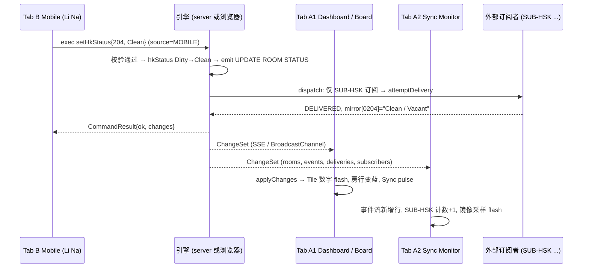
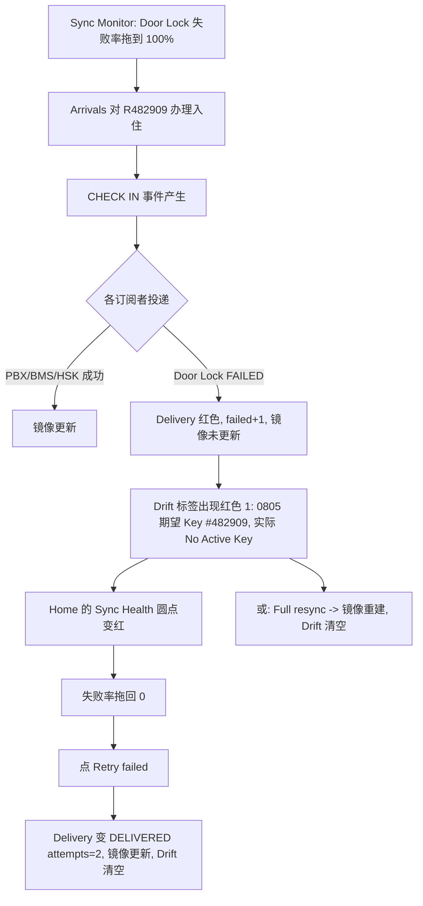

# WBS-2 界面与交互设计：OPERA Cloud 房态管理 Demo

> 版本 v1.0 · 2026-10-13 · 配套文档：`02-functional-design.md`（命令/错误码/事件的唯一依据）、`01-research-opera-room-management.md`。
> UI 文案采用 OPERA 英文标签；说明性文字（提示、空状态、指南）提供 中/EN 两套（i18n 字典），右上角 `中/EN` 切换，切换不刷新页面、选择记入 `localStorage('opera-demo:lang')`。
> 工程实现：React + Vite + TS，hash router；所有读取来自 `Snapshot`（经 `applyChanges` 合并），所有写入经 `exec(command)` → `CommandResult`。

---

## 1. Design Tokens

### 1.1 颜色（CSS 变量，定义在 `:root`，暗色不在本期范围）
| Token | 值 | 用途 |
|---|---|---|
| `--c-header-bg` | `#312D2A` | 顶栏背景（OPERA 深褐灰） |
| `--c-header-fg` | `#FFFFFF` | 顶栏文字 |
| `--c-header-line` | `#F0751A` | 顶栏顶部 3px 橙线 / 强调 |
| `--c-menubar-bg` | `#FFFFFF`，下边框 `#D9D6D3` | 菜单栏 |
| `--c-accent` | `#F0751A` | 主强调/当前菜单下划线 |
| `--c-link` | `#00758F` | 链接、可点击数字（Teal） |
| `--c-link-hover` | `#005A6E` | |
| `--c-bg` | `#F5F4F2` | 页面背景 |
| `--c-surface` | `#FFFFFF` | 卡片/表格/面板 |
| `--c-border` | `#D9D6D3` | 边框 |
| `--c-text` | `#161513` | 正文 |
| `--c-text-muted` | `#6B6560` | 次要文字 |
| `--c-primary` | `#00758F` | 主按钮背景（文字白） |
| `--c-danger` | `#C74634` | 危险/错误（Oracle Redwood 红） |
| `--c-warn` | `#B7791F` | 警告 |
| `--c-ok` | `#2E7D32` | 成功 |

**房态状态色**（`StatusBadge`、Grid 瓷砖、Tile 图标统一使用，务必同时配图标/缩写以保证色盲可辨）
| 状态 | Token | 背景 | 前景/图标 | 缩写 | 图标 |
|---|---|---|---|---|---|
| Inspected | `--st-inspected` | `#2E9E5B` | 白 | IP | 剪贴板对勾 |
| Clean | `--st-clean` | `#2B7FD6` | 白 | CL | 闪光 ✦ |
| Pickup | `--st-pickup` | `#F2A33A` | 深色 `#3A2600` | PU | 扫帚/半闪光 |
| Dirty | `--st-dirty` | `#D9402F` | 白 | DI | 垃圾桶 |
| Out of Order | `--st-ooo` | `#2B2B2B` | 白 | OO | 禁止符 ⛔ |
| Out of Service | `--st-oos` | `#7A5BA6`（紫） | 白 | OS | 扳手 |
| Occupied（FO） | — | 文字 + 实心人形 | | OCC | |
| Vacant（FO） | — | 文字 + 空心人形 | | VAC | |

**差异色**：Skip `#C74634`（红三角）、Sleep `#7A5BA6`（紫三角）、Person `#B7791F`（琥珀三角）；行背景浅色 `rgba(色,0.08)`。
**服务状态**：DND 红点徽标 "DND"；MUR 蓝点徽标 "MUR"。**VIP**：金色圆点 `#C9A227` + 代码。**队列**：青色小队列图标。

### 1.2 字体与间距
- 字体：`"Oracle Sans", "Segoe UI", "PingFang SC", "Microsoft YaHei", system-ui, sans-serif`；基准 14px/20px；标题 H1 20px/600、H2 16px/600；表格 13px；数字 Tile 28px/600 等宽数字 (`font-variant-numeric: tabular-nums`)。
- 间距刻度 4/8/12/16/24/32；圆角 4px（输入/按钮）、8px（卡片/Tile）；阴影 `0 1px 2px rgba(0,0,0,.12)`；焦点环 `2px solid #00758F`。
- 行高：表格行 36px，紧凑模式 28px。

### 1.3 布局网格
- 桌面最小宽度 1280（可用 ≥1024）；内容区最大宽 1600，左右 padding 24。
- 12 列栅格，列间距 16。Dashboard Tile 默认跨 3/4/6 列。
- 顶部固定：Header 48px + MegaMenu 40px = 88px；页面标题栏（PageHeader）56px。
- `#/mobile` 独立布局：居中 390×780 的手机外框（圆角 36px、灰色边、刘海装饰），框外背景 `#E9E7E4`；窗口 <500px 时去掉外框铺满。

---

## 2. 全局壳 (App Shell)

```
┌──────────────────────────────────────────────────────────────────────────────────────────────┐
│▀▀▀▀▀▀▀▀▀▀▀▀▀▀▀▀▀▀▀▀▀▀▀▀▀▀▀▀▀▀ 3px 橙线 #F0751A ▀▀▀▀▀▀▀▀▀▀▀▀▀▀▀▀▀▀▀▀▀▀▀▀▀▀▀▀▀▀▀▀▀▀▀▀▀▀▀▀▀▀▀▀▀▀▀▀│
│ ☰  ◉OPERA Cloud(Demo)   Business Date: 13-Oct-2026   DEMO1 - OPERA Demo Hotel      ●Live  中/EN  [Front Desk Agent ▾]│  Header #312D2A
├──────────────────────────────────────────────────────────────────────────────────────────────┤
│ OPERA Cloud │ Front Desk ▾ │ Inventory ▾ │ Integration (OHIP) ▾ │ Miscellaneous ▾ │ Guide     │  MegaMenu
├──────────────────────────────────────────────────────────────────────────────────────────────┤
│  <Page content>                                                                  Toast stack ▸│
└──────────────────────────────────────────────────────────────────────────────────────────────┘
```

### 2.1 Header
| 元素 | 行为 |
|---|---|
| 汉堡 ☰ | 窄屏时展开菜单；桌面隐藏 |
| Logo + "OPERA Cloud (Demo)" | 点击 → `#/` |
| Business Date | `hotel.businessDate`，格式 `DD-MMM-YYYY`；夜审后更新并短暂高亮 2s |
| 物业 | 固定 `DEMO1 - OPERA Demo Hotel`（`hotel.hotelId - hotel.name`） |
| 连接指示器 | 绿点 `Live`（SSE 已连/local backend 就绪）；黄点 `Reconnecting…`（SSE 断开，指数退避 1/2/4/8s，成功后拉取全量快照）；红点 `Offline`（>30s）。Tooltip 显示后端形态（`Server SSE` / `Local (BroadcastChannel)`）与 `version` |
| 语言 中/EN | 切换 i18n |
| 用户/角色切换 | 下拉：Front Desk Agent / HK Supervisor / Room Attendant / Integration Admin；切换后：①更新 actor 名（OC-FD1/OC-HK1/所选客房员/OC-INT）与 source（Room Attendant 在 `#/mobile` 为 MOBILE，其余 OPERA_UI）；②菜单项按角色显示/置灰（见下表）；③Room Attendant 自动跳 `#/mobile`；记入 `localStorage('opera-demo:role')` |
| Sync pulse | 收到**远端**变更（非本标签发起）时：连接指示点放大发光 600ms + 页面顶部橙线短暂闪烁；若变更涉及当前页可见房间，该行/瓷砖高亮 1.5s（见 §3.12） |

**角色 → 菜单可见性**
| 菜单 | Front Desk | HK Supervisor | Room Attendant | Integration Admin |
|---|---|---|---|---|
| Front Desk（Arrivals/In House/Queue） | 读写 | 只读 | 隐藏 | 只读 |
| Inventory（Board/Grid/Discrepancies/OOO/Task Sheets） | 只读（可改单房 HK 状态） | 读写 | 隐藏 | 只读 |
| Integration | 隐藏 | 隐藏 | 隐藏 | 读写 |
| Miscellaneous（End of Day） | 隐藏 | 隐藏 | 隐藏 | 读写 |
| Guide / `#/` | 全部可见 | | 仅 Guide | |
"只读"= 写操作按钮 disabled + Tooltip "Not permitted for this role"。Demo 允许用户随时切换角色，不是安全边界。

### 2.2 MegaMenu
悬停（或点击）展开二级面板，多列：
```
OPERA Cloud      → Home (#/)
Front Desk       → Arrivals (#/front-desk/arrivals) | In House (#/front-desk/in-house) | Queue Rooms (#/front-desk/queue)
Inventory        → Room Management:  Housekeeping Board | Room Status Grid | Room Discrepancies | Out of Order / Out of Service | Task Sheets
Integration (OHIP) → OHIP Sync Monitor (#/integration/sync-monitor) | OHIP API Console (#/integration/api-console)
Miscellaneous    → End of Day / Night Audit (#/misc/end-of-day)
Guide            → 演示指南 (#/guide)
```
当前页所在顶层菜单项下方 3px 橙色下划线；Esc 关闭；键盘 ←/→ 切换顶层项，↓ 进入面板。Inventory 菜单项右侧显示红色小徽标 = 待处理 Discrepancies 数（点击不跳转，仅提示）。

### 2.3 Toast 规范
| 场景 | 类型/颜色 | 内容 | 停留 |
|---|---|---|---|
| `CommandResult.ok` | success 绿 | `message` | 3s |
| ok 且 `warnings[]` 非空 | 复合：绿色主 toast + 每条 warning 一个琥珀 toast（或合并为可展开列表） | warnings | 6s，可手动关闭 |
| `!ok` | error 红 | `error`（+ 小字 `errorCode`） | 8s，需手动关闭或点 ✕ |
| 远端变更（别的标签/外部 API） | info 蓝灰，小号 | 如 "Li Na (MOBILE): Room 204 Dirty → Clean"（由 `events` 增量生成，节流：1s 内合并为"N changes"） | 3s |
| `QUEUE ROOM READY` | 带按钮的 toast | "Room 803 is ready for Kim, Ming" `[Go to Queue]` | 10s |
- 堆叠在右下，最多 4 条；`aria-live="polite"`（错误用 `assertive`）。
- 命令返回需要后续动作的 errorCode（`ROOM_NOT_READY`、`ROOM_TYPE_MISMATCH`、`DUE_OUTS_PENDING`、`NO_ROOM`）**不弹 error toast，而是弹 Modal**（见各页）。

---

## 3. 共享组件

### 3.1 PageHeader + Breadcrumb
```
Inventory › Room Management › Housekeeping Board                         [I Want To… ▾]
Housekeeping Board                                                         [ ⟳ ] [ ⛶ ]
```
Props：`breadcrumb[]`、`title`、`actions`（右侧，放 ActionMenu/主按钮）、`subtitle?`。面包屑末项不可点；前项为链接。

### 3.2 SearchPanel
可折叠面板（标题栏 "Search ▾"，状态记 `sessionStorage`）。
```
┌ Search ────────────────────────────────────────────────────── [More Filters ▾] ┐
│ Room From [____] To [____]   Floor [multi ▾]  Room Type [multi ▾]               │
│ (More) HK Status [multi ▾] FO Status [▾] Reservation Status [multi ▾] ...        │
│                                                  [ Clear ]   [ Search ]          │
└──────────────────────────────────────────────────────────────────────────────────┘
```
- 字段类型：Text、MultiSelect（带复选框与"x selected"摘要）、Select、DateRange、Checkbox。
- 行为：`Search`/回车 应用过滤；`Clear` 重置；过滤条件同步到 URL query（如 `#/inventory/housekeeping-board?hk=Dirty,Pickup&fo=Vacant`），因此 Dashboard Tile 可深链；Snapshot 变化时**结果自动按当前已应用过滤重算**（不需要重新点 Search）；已应用过滤以 chips 显示在表格上方，chip ✕ 可单独移除。
- 房号范围按**字符串**比较（From/To 字典序；仅填 From → 其后全部），与 OPERA 一致。

### 3.3 DataTable
| 能力 | 规范 |
|---|---|
| 列定义 | `{key, header, width, sortable, render, align}`；固定首列（复选框 + 房号）；表头粘性 |
| 选择 | 首列复选框；表头复选框 = 全选**当前过滤结果**（tri-state）；Shift+点击范围选择；选择集按 `id` 保存，数据刷新后保留仍存在的项；工具栏显示 "N selected  [Clear selection]" |
| 排序 | 点击表头：升→降→无；房号列使用自然排序（字符串，补零后比较）；多列排序不做 |
| 行操作 | 末列 ⋮ 菜单（RowActions）；整行 hover 高亮；双击行 = 默认动作（各页定义） |
| 行内状态 | `StatusBadge`、差异三角、DND/MUR 徽标、VIP 点 |
| 分页 | 前端分页，默认 50/页（页脚 "1–50 of 96"，可选 25/50/100）；Grid 等不分页 |
| 空/加载 | 见 §3.10；骨架行 8 行 |
| 实时更新 | 单元格值变化时该行背景闪烁 `--c-accent` 15% 1.5s（`data-flash`）；行排序不因变更而重排（避免"跳行"），除非用户重新点击排序/Search |
| 可访问性 | `role="grid"`，↑↓ 移动行焦点，空格切换选择 |

### 3.4 StatusBadge / StatusIcon
- `StatusBadge status="Clean"`：圆角胶囊，背景为状态色，文字 `Clean`（`size=sm` 仅图标+缩写 `CL`）。Tooltip：`Clean (CL)`。
- `status` 取值 = `DisplayRoomStatus`；OOO/OOS 徽标附带 `to` 日期 Tooltip（"Out of Order until 16-Oct, PLB"）。
- `FoBadge`：Occupied（实心）/Vacant（空心）。`ResvStatusText`：纯文字（Arrival/Arrived/Stay Over/Due Out/Departed/Day Use/Not Reserved）。
- `DiscrepancyBadge type`：三角 + "Skip/Sleep/Person"，Tooltip 说明（"FO Occupied / HK Vacant"）。

### 3.5 Tile（Dashboard 磁贴）
卡片：标题栏（标题 + 右上"↗"进入页面）、内容区、可选脚注。Tile 内每个数字是 `<a>`（teal，hover 下划线），点击 → 深链到过滤页面。加载时骨架；数据变化时数字 flash。

### 3.6 ActionMenu "I Want To…"
- 按钮 `I Want To… ▾`（描边按钮），下拉分组菜单（分隔线分组）。项可为 disabled（并显示原因 Tooltip，例如"Select at least one room"）。
- 菜单项选中后打开 Modal 或 Drawer，不直接执行。键盘：Enter 打开，↑↓ 选择。
- 同一组件用于行级 ⋮ 菜单（RowActions）。

### 3.7 Drawer
右侧滑出，宽 480（Room History 640）；遮罩可点击关闭（有未保存修改时确认）；标题栏 + 内容滚动 + 底部固定 `[Cancel] [Save]`。Esc 关闭。内容变化实时刷新（如 Room History 随新事件追加）。

### 3.8 Modal
居中，宽 480/640；标题、正文、底部按钮（主按钮右，次按钮左）。三类：①表单 Modal（OOO 创建等）；②确认 Modal（升级、Early departure）；③"后续动作" Modal（ROOM_NOT_READY 等，按钮为动作选项）。焦点陷阱；Esc = Cancel；提交中按钮显示 spinner 并禁用。

### 3.9 Tabs
下划线式（选中项橙色 3px 下划线）。`Tabs items=[{key,label,badge?}]`，当前 tab 记 URL query `?tab=`。Badge 为计数（如 Drift 数，红底白字）。

### 3.10 EmptyState / Loading / Error
| 状态 | 展现 |
|---|---|
| 初次加载 | 页面骨架（表格 8 行灰条；Tile 灰块）；`snapshot==null` 时全局显示，超过 5s 显示 "Still connecting… [Retry]" |
| 无结果 | 居中插画图标 + 标题 "No rooms match your search" + 说明 + `[Clear filters]` |
| 空数据（业务上就是没有） | 如 "No discrepancies — all rooms agree with Front Office ✔" |
| 加载失败 | 红色横幅 "Cannot reach server" + `[Retry]`；不阻塞已有缓存数据显示 |
| 命令提交中 | 触发控件 disabled + 行内 spinner；local backend 命令同步完成，无 spinner |

### 3.11 表单与校验规范
- 必填字段标 `*`；校验失败：字段红框 + 下方红字；提交按钮不禁用（点击后聚焦首个错误）。
- **引擎错误回显**：`!ok` 时先看 `errorCode` 的映射（见各页）；未映射则在 Modal 顶部显示红色 Alert（`error` + 小字 code），Modal 保持打开以便修正。
- 日期输入 `DD-MMM-YYYY` 显示，内部 ISO；日期选择器最小值 = 业务日期（OOO 创建）。
- 多房操作：成功后的 Toast 汇总 `message`，部分跳过的 `warnings` 逐条列出。

### 3.12 "变更高亮"与 Sync pulse 规范
| 触发 | 表现 |
|---|---|
| 任何 ChangeSet 合并导致某房（`rooms[]`）或预订变化 | 对应行/瓷砖 flash 1.5s（本标签发起的变化也 flash，保持一致性） |
| 变更来源为远端（SSE/Broadcast 收到且 `version` 非本标签 exec 产生） | 额外：Header Sync pulse + info toast（节流） |
| 新业务事件追加 | Sync Monitor 事件流顶部新行滑入，`bg: accent 10%` 淡出 |
| `reset`（夜审/Reset） | 整页内容淡入 + toast "Business date rolled…" / "Demo data has been reset" |

### 3.13 数据层约定（供前端实现）
```ts
useSnapshot(): Snapshot | null          // 合并后的当前快照
useViews(): RoomView[]                  // useMemo(roomViews(snapshot))，所有页面共享
exec(cmd: Command): Promise<CommandResult>   // 内部带 actor（来自角色），写后无需手动刷新
useEventsFor(roomId): BusinessEvent[]   // events.filter(e => e.roomIds.includes(roomId))
```
- 所有列表由 `RoomView`/`Reservation` 派生，过滤逻辑放页面层，不复制引擎公式；就绪判断统一调用 `isRoomReady(snapshot, room)`。
- `exec` 返回后立即用 `changes` 乐观合并（server 模式下 SSE 也会推送同一 ChangeSet，靠 `version` 去重）。

---

## 4. 页面设计

通用约定：
- 每页顶部 PageHeader；表格页为"SearchPanel + 工具栏 + DataTable"；所有数字/状态均实时。
- 命令错误按 §3.11 与 02 文档 §6.1 的 errorCode 表处理。下文只写页面特有部分。

---

### 4.1 `#/` Home Dashboard

**目的**：OPERA Cloud 首页风格总览；从任何 Tile 钻取到过滤后的明细页。

```
┌ Home ───────────────────────────────────────────────────────────────────────────────────────┐
│ ┌ Room Status ─────────────────────────┐ ┌ Queue Reservations ────┐ ┌ Room Summary ────────┐ │
│ │      ✔IP       ✦CL       ◐PU      🗑DI │ │  In Queue      3       │ │ Physical Rooms   96  │ │
│ │ Occ    1         8         0      42  │ │  Current wait  12 min  │ │ Inventory Rooms  95  │ │
│ │ Assgn  6         3         0       3  │ │  Avg wait      9 min   │ │ Out of Order      1  │ │
│ │ Vacant 12        8         0      11  │ │  Ready rooms   1 / 3   │ │ Out of Service    1  │ │
│ └──────────────────────────────────────┘ │  [View Queue]          │ │ Occupancy     53.7%  │ │
│ ┌ Arrivals ───────────┐ ┌ Departures ──┐ └────────────────────────┘ └──────────────────────┘ │
│ │ Expected 22  Unassg 10│ │ Expected 17  │ ┌ Discrepancies ──────┐ ┌ Sync Health ─────────────┐ │
│ │ Checked-in 0         │ │ Departed 9   │ │ Skip 1 Sleep 1 Pers 1│ │ ●HSK ●PBX ●LOCK ●BMS ●CHN│ │
│ └──────────────────────┘ └──────────────┘ │ [View]               │ │ Failed 0  Drift 0        │ │
│ ┌ Housekeeping Progress by Attendant ───────────────────────────────┐ └──────────────────────────┘ │
│ │ Li Na      ████████░░░░ 8/20 rooms · 96/210 cr                     │                              │
│ │ Wang Fang  ...                                                      │                              │
│ │ Unassigned ░░░░ 14 rooms                                           │                              │
│ └────────────────────────────────────────────────────────────────────┘                              │
└─────────────────────────────────────────────────────────────────────────────────────────────────────┘
```

**Tile 定义与数据源**
| Tile | 内容 | 公式（02 §4.3） | 点击钻取 |
|---|---|---|---|
| Room Status | 4 列状态图标（Inspected 绿剪贴板/Clean 蓝闪光/Pickup 橙/Dirty 红垃圾桶）× 3 行（Occupied/Assigned/Vacant） | `roomStatusTile(views)`；仅 `pickupStatusEnabled`/`inspectedStatusEnabled` 为 true 的列显示（否则灰显 "N/A"） | 数字 → `#/inventory/housekeeping-board?hk=<Status>&fo=Occupied`（Occupied）；Assigned → `?hk=<Status>&fo=Vacant&resv=Arrival`；Vacant → `?hk=<Status>&fo=Vacant&resv=NotArrival`；状态图标头 → `?hk=<Status>`；标题 ↗ → Room Status Grid |
| Queue Reservations | In Queue 数、Current wait（队首等待分钟）、Avg wait、Ready rooms（排队预订中房就绪数/总数） | `queueReservations(s)` + `minutesSince` + `isRoomReady`；每分钟刷新一次分钟数（定时器，非数据事件） | → `#/front-desk/queue` |
| Room Summary | Physical / Inventory / OOO / OOS / Occupancy% | `roomSummary` | Physical → Board；OOO → `#/inventory/out-of-order?type=OOO`；OOS → `?type=OOS`；Inventory/Occupancy 无链接 |
| Arrivals / Departures | Expected、Unassigned、Departed、Checked-in（= 今日 `Reserved→InHouse` 的到店数 = `InHouse ∧ arrival=D ∧ arrival≠departure`） | `roomSummary` + reservations | → Arrivals (`?filter=unassigned`) / In House (`?filter=dueout`) |
| Discrepancies | Skip/Sleep/Person 计数（按类型） | `views.discrepancies` | → `#/inventory/discrepancies?type=Skip` 等 |
| Housekeeping Progress by Attendant | 每位客房员：已完成房数/分配房数（完成 = Clean/Inspected）、credits 进度条；另一行 Unassigned（需清洁但无人分配的 Dirty/Pickup 房数） | 由 `room.attendantId`、`credits` 派生 | 点击客房员 → Task Sheets 定位该员；Unassigned → Board `?att=none&hk=Dirty,Pickup` |
| Sync Health | 5 个订阅者圆点（绿=启用且无 FAILED/无漂移；琥珀=有漂移；红=有 FAILED 投递；灰=禁用）、Failed 总数、Drift 总数 | `subscribers`+`deliveries`+`drift()` | → Sync Monitor（点某圆点 → 定位该订阅者 Tab） |

**交互**：Tile hover 轻微上浮；数字 0 时不显示链接样式（灰色）。
**空/加载**：Tile 骨架；`snapshot` 就绪即渲染。
**实时**：所有 Tile 订阅 Snapshot，任一命令/远端变更后 ≤1 帧更新；变化的数字 flash；queue 等待分钟每 60s 自刷新。

---

### 4.2 `#/inventory/housekeeping-board` Housekeeping Board

**目的**：房务主控制台；搜索、查看、批量改房态、分配客房员、OOO/OOS、查看房间历史。

```
Inventory › Room Management › Housekeeping Board                                 [I Want To… ▾]
┌ Search ─────────────────────────────────────────────────────────────── [More Filters ▾] ┐
│ Room From [   ] To [   ]  Floor [▾]  Room Type [▾]  HK Status [▾]  FO Status [▾]         │
│ (More) Reservation Status [▾] Service Status [▾] Turndown [▾] Attendant [▾] Condition [▾]│
│        ☐ Discrepancies only  ☐ Due Out only  ☐ Queue rooms only          [Clear][Search] │
└───────────────────────────────────────────────────────────────────────────────────────────┘
 ✔IP 13 │ ✦CL 20 │ ◐PU 0 │ 🗑DI 56 │ ⛔OO 1 │ 🔧OS 1      ← 状态汇总条(点击=按该状态过滤)
 Results 96 · 3 selected [Clear]                         [Set Room Status ▾]  [Assign Attendant]
┌─┬──────┬──────────┬──────────┬──────┬──────────┬──────────┬───────────┬─────┬─────┬───────┬────────┬───┐
│☐│ Room │ Room Type│ HK Status│ FO   │ Resv Stat│ Guest    │ Arr / Dep │ Pers│ Svc │Turndn │Attendnt│ ⋮ │
├─┼──────┼──────────┼──────────┼──────┼──────────┼──────────┼───────────┼─────┼─────┼───────┼────────┼───┤
│☑│ 204  │ SK       │ [Dirty]  │ Vac  │ Not Resv │          │           │ 0/- │     │  -    │ Li Na  │ ⋮ │
│☐│ 205  │ SK  ⏳Q  │ [Dirty]  │ Vac  │ Arrival  │ Nguyen,Y │13-Oct/15  │ 0/- │     │  -    │ —      │ ⋮ │
│☐│ 306  │ SK       │ [Dirty]  │ Occ  │ Due Out  │ Brown,W  │11-Oct/13  │ 2/2 │     │       │ —      │ ⋮ │
│☐│ 511  │ DK  ▲Skip│ [Clean]  │ Occ  │ Stay Over│ Lopez,W  │…          │ 3/0 │     │       │        │ ⋮ │
└─┴──────┴──────────┴──────────┴──────┴──────────┴──────────┴───────────┴─────┴─────┴───────┴────────┴───┘
```

**搜索字段**（对应调研 §3.1，Demo 子集）：Room From/To（字符串范围）、Floor（2–9 多选）、Room Type（SK/ST/DK/JS/ES 多选）、HK Status（Inspected/Clean/Pickup/Dirty/Out of Order/Out of Service；启用参数才出现 Inspected/Pickup）、FO Status、Reservation Status（7 种）、Service Status（DND/MUR/None）、Turndown、Attendant（含 Unassigned）、Condition、Section（A–D）、勾选项 Discrepancies only / Due Out only / Queue rooms only / Room Features（NS/CV/LV/ACC）。URL query 键：`from,to,floor,type,hk,fo,resv,svc,td,att,cond,sec,disc,dueout,queue`。

**表格列**：☐ | Room(+条件徽标 SHW/HLD…) | Room Type | HK Status(StatusBadge；OOO/OOS 显示 OO/OS) | FO Status | Reservation Status | Guest（姓名+VIP点；Arrival 取到店预订，Departed 取已退房预订） | Arr/Dep 日期 | Persons（`FO/HK`，不一致时橙色） | Service(DND/MUR) | Turndown | Attendant | Discrepancy(三角) | Last Change(时间+actor，Tooltip) | ⋮。默认排序：房号升序。

**交互**
- **多选 + 批量**：选中 ≥1 行后工具栏启用 `Set Room Status`、`Assign Attendant`；同时 I Want To… 菜单相应项启用。
- **Set Room Status（Modal，批量）**：
  ```
  ┌ Set Room Status (3 rooms) ─────────────────────┐
  │ Room Status *  (•) Inspected ( ) Clean ( ) Pickup ( ) Dirty │
  │ ▸ Housekeeping Status (observation)                          │
  │     Occupancy ( ) Vacant ( ) Occupied   Persons [ 1 ]        │
  │ Turndown  [Not Required ▾]    ☐ Prioritize (queue room only)│
  │ Rooms: 204, 205, 306                                          │
  │                                   [Cancel] [Save]           │
  └──────────────────────────────────────────────────────────────┘
  ```
  Save 依次 `setHkStatus`（若选了状态）→ `setHkOccupancy`（若展开并选择，逐房；Persons 仅 Occupied 可用）→ `setTurndown`（若变更）。Inspected/Pickup 选项仅在参数启用时可选，否则 disabled + Tooltip（`PARAM`）。结果：每条命令的 message 合并为一个 Toast；`ROOM_OOO` 跳过的房列在 warning 中；全部被跳过 → 错误 Toast + Modal 保持打开。Persons 展开项初始显示该房 FO 人数（OPERA 行为：Person 差异录入）。
- **I Want To… 菜单**
  | 项 | 前置 | 动作 |
  |---|---|---|
  | Set Room Status | ≥1 选中 | 上述 Modal |
  | Set Service Status | ≥1 选中 | Modal：DND / MUR / Clear；跳过空房 warning（见 `setServiceStatus`） |
  | Set Turndown | ≥1 | Modal：Required / Not Required / Completed |
  | Room Condition | ≥1 | Modal：条件下拉（含 None），显示 `blocksAssignment` 提示；已排房警告 |
  | Assign Attendant | ≥1 | Modal：客房员下拉（含 Unassigned，显示各员当前 credits/上限） |
  | Place Out of Order / Out of Service | ≥1 | 打开 §4.5 的创建 Modal，房间预填 |
  | Room History | 恰好 1 | 打开 Drawer |
  | View Reservation | 恰好 1 且有预订 | Drawer 显示预订摘要（只读） |
- **行 ⋮ 菜单**：Set Room Status / Assign Attendant / Place OOO·OOS / Room History / Resolve Discrepancy（有差异时）。**双击行 = Room History**。
- **Room History Drawer**：头部房号、房型、当前 HK/FO/Display 状态徽标；正文为时间线：`events.filter(roomIds ∋ room)` 倒序，每项显示时间、`eventName`、actor（source 图标：UI/手机/API/PBX）、`summary`、可展开 `details`（old→new）。Snapshot 仅保留最近 500 条事件，底部提示 "Showing last N events (demo keeps 500)"。新事件到达时顶部追加并高亮。
- 状态汇总条：每个徽标 = 当前**过滤前**全部房间计数（含 OO/OS）；点击 = 以该状态过滤（再点取消）。

**校验与错误**
| errorCode | 展示 |
|---|---|
| `PARAM` | Modal 内红字 "Inspected status is not enabled…" + 链接 "Open property parameters" → `#/misc/end-of-day` |
| `ROOM_OOO`（全部跳过） | Toast error；部分跳过 → warning 列出 |
| 选择为空 | 工具栏按钮 disabled |

**空/加载**：见 §3.10；无结果时 EmptyState + Clear filters。
**实时**：表格行与汇总条随 Snapshot 更新；他人修改的行 flash；排序/选择不丢失；Room History Drawer 实时追加。

---

### 4.3 `#/inventory/room-grid` Room Status Grid

**目的**：楼层 × 房间的瓷砖总览，一眼看全馆房态，并快速改单房状态。

```
Inventory › Room Management › Room Status Grid            View by: (•)HK Status ( )FO Status ( )Section
Legend: ✔Inspected ✦Clean ◐Pickup 🗑Dirty ⛔OOO 🔧OOS │ ▲Discrepancy  ⏳Queue  ●DND ●MUR ⚑VIP ☰Show filter [Floor▾][Type▾]
Floor 9  [901][902][903][904][905][906][907][908][909][910][911][912]
Floor 8  [801][802][803][804][805]…
 …
Floor 2  [201][202]…
        ┌─ tile ──┐
        │ 204  SK │  ← 背景=状态色；左上房号，右上房型；底部图标行：FO人形、▲、DND/MUR、Q、客房员首字母
        └─────────┘
```
- **瓷砖**：76×60px；背景=显示状态色；Occupied 瓷砖左侧加 4px 深色竖条；右下客房员首字母圆标（如 "LN"）；OOO/OOS 斜纹底；选中态：2px 黑色描边。
- **视图切换**：HK Status（默认）/ FO Status（Occupied 深/Vacant 浅）/ Section（A–D 四色）。
- **过滤**：楼层、房型、"仅显示 Dirty/Pickup"、"仅差异"、"仅我的客房员"；顶部计数 chip。
- **Quick-change Popover**（点击瓷砖）：
  ```
  ┌ 204 · SK · Vacant ─────────────┐
  │ Display: Dirty    Attendant: Li Na│
  │ Set to:  [Inspected][Clean][Pickup][Dirty]  ← 当前态 disabled
  │ HK observed: [Vacant][Occupied]  Persons[ ]
  │ Service: [DND][MUR][Clear] (仅占用房)
  │ [Room History]  [More… → Board]            │
  └────────────────────────────────────┘
  ```
  点按钮即时 `exec`（单房 `setHkStatus`/`setHkOccupancy`/`setServiceStatus`），成功后 popover 保持打开并刷新；OOO/OOS 房状态按钮全部 disabled，改为显示 "Return to Service" 链接（→ §4.5）。Esc/点外部关闭。
- **Hover**：Tooltip：房号、房型、HK/FO/Resv 状态、客人、离店日、Last change。
- **Shift/Ctrl 多选**（可选增强）：选中多块后顶部出现 "Set Room Status…" 同 Board Modal。
- **实时**：瓷砖颜色变化带 300ms 过渡并 flash；远端变化时右上角计数 chip 同步；popover 开着时若该房被远端改动，popover 内容刷新并显示小提示 "Updated by <actor>"。
- **空/加载**：骨架瓷砖 96 个；过滤后无房时 EmptyState。

---

### 4.4 `#/inventory/discrepancies` Room Discrepancies

**目的**：显示 FO 与 HK 不一致的房间（Skip/Sleep/Person）并解除。

```
Inventory › Room Management › Room Discrepancies
┌ Search ─ Room From/To  Floor  Room Type  Discrepancy [☑Skip ☑Sleep ☑Person]  ☐ Due Out Only ──[Clear][Search]┐
 Results 3    [Resolve Selected]
┌─┬──────┬──────┬────────────┬──────────┬──────────┬─────────┬────────┬───────────────────┬────────┐
│☐│ Room │ Type │Discrepancy │ FO Status│ HK Status│ FO Pers │ HK Pers│ Guest / Resv      │ Action │
├─┼──────┼──────┼────────────┼──────────┼──────────┼─────────┼────────┼───────────────────┼────────┤
│☐│ 511  │ DK   │ ▲ Skip     │ Occupied │ Vacant   │   3     │   0    │ Lopez, Wei #482161│[Resolve]│
│☐│ 211  │ DK   │ ▲ Sleep    │ Vacant   │ Occupied │   0     │   1    │ —                 │[Resolve]│
│☐│ 711  │ DK   │ ▲ Person   │ Occupied │ Occupied │   1     │   4    │ Brown, Kenji      │[Resolve]│
```
- 数据：`views.filter(discrepancies.length>0)`，每种差异一行（一房多种差异显示多行，选择按房）。
- **Resolve**（行内/批量）：弹确认 "Align Housekeeping status with Front Office for room 511?"（说明：Skip 需先核实客人是否离店）→ `resolveDiscrepancy`；批量逐房执行并汇总。
- **更多动作**（⋮）：Check Out（Skip 时，跳转 In House 并预选）、Check In（Sleep 时，跳转 Arrivals 过滤该房）、Room History、Set Room Status。
- **Due Out Only**：`resvStatus=Due Out`。
- **错误**：`resolveDiscrepancy` 对已无差异房（并发被他人解决）返回 VALIDATION → 自动刷新并 Toast "Already resolved"。
- **空状态**："No discrepancies — Front Office and Housekeeping agree ✔"。
- **实时**：他人（Mobile）报告新差异 → 行滑入 + Header 菜单徽标 +1 + info toast "Room 206: Sleep discrepancy detected"；被解决的行淡出（1s 后移除）。

---

### 4.5 `#/inventory/out-of-order` Out of Order / Out of Service

**目的**：管理 OOO/OOS 记录（创建、查看、Return to Service），演示库存影响与冲突校验。

```
Inventory › Room Management › Out of Order / Out of Service            [ + New ]
Tabs: [ All ] [ Out of Order (2) ] [ Out of Service (1) ] [ Future (1) ]
┌ Search: Room From/To  Room Type  Date range [From][To]  Reason ▾ ───────────[Clear][Search]┐
┌─┬──────┬──────┬──────┬────────────┬────────────┬────────┬──────────────────┬───────────┬──────┬───┐
│☐│ Room │ Type │ Kind │ From       │ To         │ Reason │ Return Status    │ Remarks   │ State│ ⋮ │
│☐│ 703  │ SK   │ OOO  │ 12-Oct     │ 15-Oct     │ PLB    │ Dirty            │ Leak…     │Active│ ⋮ │
│☐│ 810  │ DK   │ OOS  │ 13-Oct     │ 13-Oct     │ FUR    │ Inspected        │ TV…       │Active│ ⋮ │
│☐│ 210  │ DK   │ OOO  │ 16-Oct     │ 19-Oct     │ RNV    │ Dirty            │ Carpet    │Future│ ⋮ │
Summary: Inventory impact today:  Physical 96 − OOO 1 = Inventory 95    (OOS 1 stays in inventory)
```
- 数据：`rooms.filter(outOfOrder)`；State = Active（`from ≤ D ≤ to`）/Future（`from > D`）；Tab：All / OOO / OOS / Future；底部"库存影响"栏实时显示 Room Summary 的 Physical/OOO/Inventory。
- **+ New（Modal）**
  ```
  ┌ New Out of Order / Out of Service ─────────────────────────┐
  │ Type *     (•) Out of Order   ( ) Out of Service           │
  │ Rooms *    [chips: 206 ×] [+ Add room…]  或 Range [From][To]│
  │ From *     [13-Oct-2026]   Through *  [14-Oct-2026]         │
  │ Reason *   [PLB – Plumbing / water leak ▾]                  │
  │ Return Status * [Dirty ▾]  (Inspected/Pickup 依参数)        │
  │ Remarks    [____________________________]                   │
  │ ⓘ OOO removes the room from inventory; OOS keeps it.        │
  │                                         [Cancel] [Save]     │
  └──────────────────────────────────────────────────────────────┘
  ```
  客户端预校验（与引擎一致）：Rooms 非空；From ≥ 业务日期；From ≤ Through；Reason 必选；Return Status=Inspected 需启用。提交 `placeOutOfOrder`。**房间选择器**默认只列"无 OOO 记录"的房，并在 Type=OOO 时标记有冲突的房（在住/已排房，灰色并提示 "Occupied until …" / "Assigned #482926"）——作为提示，最终以引擎为准。
- **冲突错误展示**（Modal 内红色 Alert，Modal 不关闭）：
  | errorCode | 文案/后续 |
  |---|---|
  | `ROOM_OCCUPIED` | "Room N is occupied by <guest> until <date>. Move the guest before placing it Out of Order." + 按钮 `[Go to In House]`（带 `?room=N`） |
  | `ROOM_ASSIGNED` | "…assigned to reservation #… Unassign it first." + `[Go to Arrivals]` |
  | `ALREADY_OOO` | "Room N already has an OOO record (from – to). Return it to service first." + `[Show record]`（过滤表格） |
  | `VALIDATION` | 字段级红字 |
  OOS 的冲突仅是 warning toast（保留可售）。
- **行 ⋮ / 批量**：`Return to Service`（`releaseOutOfOrder`，确认 Modal 显示 "Room 703 will be returned as **Dirty**"；Future 记录文案改为 "Delete future record"）、`Room History`。无 Edit（偏差 D2，按钮位置预留灰显，Tooltip "Delete and re-create to change dates"）。
- **库存联动演示**：创建 OOO 后顶部短暂高亮 "Inventory 95 → 94"；OOS 则提示 "Inventory unchanged".
- **空状态**："No Out of Order / Out of Service records"。
- **实时**：表格随 Snapshot；夜审到期记录自动消失；他人创建的记录滑入。

---

### 4.6 `#/inventory/task-sheets` Task Sheets

**目的**：按 credits 自动生成客房员任务单、手工改派、查看单员任务单。

```
Inventory › Housekeeping › Task Sheets                      [Generate Task Sheets]  [Print ⎙]
┌ Generate ───────────────────────────────────────────────────────────────┐
│ Attendants: ☑Li Na(A) ☑Wang Fang(B) ☑Zhang Min(C) ☑Chen Jing(D) ☐Maria ☐Liu │
│ Rooms:  (•) Dirty & Pickup only   ( ) All rooms needing service              │
│ Max credits/attendant: from profile (140/120)         [Generate]            │
└──────────────────────────────────────────────────────────────────────────┘
Tabs: [ Overview ] [ Li Na ] [ Wang Fang ] ... [ Unassigned (14) ]
Overview:  Attendant │ Section │ Rooms │ Credits used / max │ Done │ bar
Per sheet (tab):
┌ Task Sheet · Li Na · Section A · 12 rooms · 126 / 140 credits ──────────────────────────────┐
│ # │ Room │ Type │ Credits │ Task      │ HK Status │ Resv   │ Svc │ Done │ ⋮ (Reassign) │
│ 1 │ 201  │ SK   │ 10      │ Stayover  │ Dirty     │ StayOv │     │ ☐    │                │
```
- **Generate**：`autoAssignTasks {attendantIds, onlyDirty}`；生成后 Toast + warnings（unassigned）；Overview 刷新。重复生成会重算被选客房员范围内的目标房（不在目标集的房保持原分配）。
- **任务单（per attendant）** = `rooms.filter(attendantId = X)` 按房号排序；列：序号、Room、Type、Credits（房型 credits）、Task（派生：Resv=Due Out→`Departure`，Stay Over/Arrived→`Stayover`，Departed/Not Reserved 且 Dirty→`Vacant Clean`）、HK Status、Resv Status、Service(DND 标红提示"skip/later")、Done（= HK 为 Clean/Inspected，**只读派生**，非手工勾选）、⋮。
- 头部汇总：rooms 数、`Σcredits / maxCredits` 进度条（超限红色）、Done credits。
- **手工改派**：行 ⋮ → Reassign…（选客房员或 Unassigned）或多选后 `Assign Attendant`；拖拽改派为可选增强（拖房行到另一 tab 标题）。`assignAttendant`。
- **Unassigned tab**：需清洁（Dirty/Pickup）但无人分配的房；可多选分配。
- **错误**：Generate 未选客房员 → 内联红字 "Select at least one attendant"；credits 溢出 → warning banner "N rooms could not be assigned – attendant credit limits reached" + 列入 Unassigned。
- **空状态**："No task sheets yet — select attendants and click Generate"。
- **实时**：Mobile 上完成清洁 → 对应行 Done 变 ✔、进度条增长；夜审清空分配。

---

### 4.7 `#/front-desk/arrivals` Arrivals

**目的**：今日到店管理：排房、入住、处理房未就绪与房型不符。

```
Front Desk › Arrivals                                                   [I Want To… ▾]
┌ Search: Guest Name  Conf No  Room Type ▾  ☐Unassigned only ☐Assigned ☐In queue ☐VIP ───[Clear][Search]┐
 Tabs: [ Due In (22) ] [ Checked In (0) ]                       Arrival date: 13-Oct-2026 (Business Date)
┌─┬──────────┬──────────────┬────┬────┬──────┬─────┬──────┬──────────┬─────────────┬─────────────────┐
│☐│ Conf No  │ Guest        │VIP │ Type│ Pers │ ETA │ Nts  │ Room     │ Room Status │ Actions         │
│☐│ 482909   │ Park, Xiao   │    │ SK  │ 2    │17:00│ 2    │ 805      │ [Inspected] │[Check In] ⋮     │
│☐│ 483035   │ Nguyen, Yuki │    │ SK  │ 2    │10:30│ 2    │ 205 ⏳Q1 │ [Dirty]  ⚠  │[Check In] ⋮     │
│☐│ 483071   │ Wang, Yuki   │    │ ST  │ 2    │…    │ 3    │ —        │             │[Assign Room] ⋮  │
```
- 数据：Due In = `Reserved ∧ arrival=D`；Checked In = `InHouse ∧ arrival=D`。Room Status 列显示所排房的显示状态；未就绪的排房显示 ⚠（Tooltip "Not ready for check-in"）。行内主按钮随状态变化：无房→`Assign Room`，有房→`Check In`；排队中→`Check In`（若房就绪，按钮高亮脉冲）。
- **Assign Room（Drawer，宽 640）**
  ```
  ┌ Assign Room · Wang, Yuki · ST · 13-Oct → 16-Oct ───────────────┐
  │ Room Type [ST ▾ (reserved type)]  ☑ Ready only  ☐ Include dirty │
  │ Floor [▾]  Features [▾]                              [Search]    │
  │ ┌ Room │Type │Floor│HK Status │Cond │ Conflict ─────────────────┐│
  │ │ 309  │ ST  │ 3   │ Clean    │     │                           ││
  │ │ 209  │ ST  │ 2   │ Clean    │     │                           ││
  │ │ 407  │ ST  │ 4   │ Dirty    │     │ Not ready                 ││
  │ └────────────────────────────────────────────────────────────────┘│
  │ Selected: 309                                [Cancel] [Assign]   │
  └──────────────────────────────────────────────────────────────────┘
  ```
  候选 = 房型过滤（默认预订房型；可切换以演示升级）；"Ready only" = `isRoomReady`；排除：当日 OOO 有效/期间 OOO 重叠/条件阻止/时段冲突（灰显并给原因而非隐藏，便于理解，但不可选）；Dirty/Pickup 在未勾选 Include dirty 时隐藏；OOS 显示橙色 "OOS" 并可选（引擎仅 warning）。
- **错误处理（核心）**
  | 触发 | errorCode | UI |
  |---|---|---|
  | Assign 选了异房型 | `ROOM_TYPE_MISMATCH` | **确认 Modal**："Room 311 is DK, reservation is ST. Upgrade guest to DK?" `[Cancel] [Upgrade (Confirm)]` → 以 `force:true` 重发 |
  | Check In | `ROOM_NOT_READY` | **后续动作 Modal**：标题 "Room 803 is not ready"，正文 = 引擎 `error`；按钮：`[Add to Queue]`（`queueReservation`）、`[Change Room]`（打开 Assign Drawer）、`[Cancel]` |
  | Check In | `NO_ROOM` | 直接打开 Assign Room Drawer |
  | Check In | `ROOM_OCCUPIED` | Toast + 提示 "Go to In House" |
  | Assign | `ROOM_UNAVAILABLE` / `ROOM_CONDITION` / `ROOM_OOO` | Drawer 内红色 Alert（保持打开，并刷新候选） |
  | `NOT_ARRIVAL_DATE`/`BAD_STATE` | Toast error（并发导致，刷新） |
- **行 ⋮**：Unassign Room、Add to Queue、Remove from Queue、Room History（房）。
- **批量**：选择多行 → `Check In Selected`（逐条，汇总：N 成功 / M 因未就绪被跳过，列出 `ROOM_NOT_READY` 的预订并提供"批量加入队列"）。
- **warnings**：Assign 的 "not ready for check-in yet (consider Queue)" 以 Toast 展示并在行上标 ⚠。
- **空状态**："No arrivals for this business date"。
- **实时**：他人入住/排房 → 行状态与 Tab 计数更新；房被 Mobile 置 Clean → 该行 ⚠ 消失、Check In 按钮脉冲；Assign Drawer 内候选列表实时刷新（正在选中的房被他人占用/变脏时该行标红并禁用 Assign）。

---

### 4.8 `#/front-desk/in-house` In House

**目的**：在住客操作：退房、换房、DND/MUR。

```
Front Desk › In House                                                   [I Want To… ▾]
┌ Search: Guest Name  Room From/To  Room Type  ☐Due Out ☐Stay Over ☐Day Use ☐Discrepancy  ──[Clear][Search]┐
 Tabs: [ All (51) ] [ Due Out (17) ] [ Stay Over (33) ] [ Day Use (1) ]
┌─┬──────┬──────────────┬──────┬───────┬──────────┬─────┬─────┬────────────┬────────┬───────────┐
│☐│ Room │ Guest        │ Type │ Pers  │ Arr→Dep  │ Resv Stat│ HK Status │ Svc    │ Disc   │ Actions   │
│☐│ 306  │ Brown, Wei   │ SK   │ 2     │ 11→13-Oct│ Due Out  │ [Dirty]   │        │        │[Check Out]⋮│
```
- 数据：`InHouse` 预订 ⨝ 房间视图；Tab 依 `resvStatus`。
- **Check Out**：确认 Modal（无账务）："Check out Brown, Wei from room 306? Room will be set to Dirty."。提前离店（`departure > D`）追加提示 "Early departure: departure will change to <D>"。成功 Toast 含 "room N set to Dirty" 与 early-departure warning。
- **Room Move（Drawer）**：选目标房（候选：房型任意、`isRoomReady`、无冲突/OOO/条件阻止；异房型显示 "Type change SK → DK" 标签并要求勾选确认——前端强制，偏差 D6）、Reason（下拉 + 备注）。`roomMove`。错误：`ROOM_NOT_READY`（Alert "target must be ready"）、`ROOM_OOO`、`ROOM_UNAVAILABLE`、`ROOM_CONDITION`。成功 Toast "Moved to 304; room 302 set to Dirty"。
- **Service Status**：行 ⋮ → Set DND / Set MUR / Clear（`setServiceStatus`）。
- **其他 ⋮**：Room History、Resolve Discrepancy（有差异时）、Set Room Status（打开 Board Modal）。
- **批量**：`Check Out Selected`（Due Out tab 常用）。部分失败时汇总。
- **错误**：`BAD_STATE`（已被他人退房）→ 刷新 + Toast。
- **空状态**："No in-house guests match".
- **实时**：他人退房 → 行淡出；Mobile 报告差异 → Disc 列出现三角；Mobile 置 DND → Svc 徽标出现。

---

### 4.9 `#/front-desk/queue` Queue Rooms

**目的**：管理已到店等房的预订；监控房间就绪并通知客人。

```
Front Desk › Queue Rooms                           Avg wait 9 min · In queue 3 · Ready 1
┌ Search: Guest Name  Room Type  ☐Ready only ───────────────────────────[Clear][Search]┐
┌───┬──────────────┬──────┬──────────┬──────┬───────────┬───────────────┬─────────────────────────┐
│Pri│ Guest        │ Type │ Room     │ Wait │ Readiness │ Attendant     │ Actions                  │
│ 1 │ Nguyen, Yuki │ SK   │ 205      │ 34m  │ 🗑 Dirty  │ Li Na         │[Notify]✖ [Check In]✖ ⋮  │
│ 2 │ Tanaka, Jun  │ ST   │ 408      │ 14m  │ ✦ Clean ✔ │ Wang Fang     │[Notify] [Check In] ⋮    │
```
- 数据：`queueReservations(s)`（priority 升序、`queuedAt` 升序）。Wait = `minutesSince(queuedAt)`，每 60s 刷新（超过 30 分钟红色）。Readiness = 所排房显示状态 + `isRoomReady` 的 ✔/✖；未排房显示 "No room assigned" + `[Assign Room]`。
- **Notify**：房就绪后启用。引擎无通知命令（偏差 D17）：点击 → 前端弹出"短信预览 Modal"（"Dear Nguyen, Yuki, your room 205 is ready…"）+ `Send`（仅本地 Toast "SMS sent (simulated)"，并在行上标 "Notified 10:42"，记入页面 state/localStorage）。`QUEUE ROOM READY` 事件到达时自动弹带 `[Go to Queue]` 的 toast，行高亮并置顶排序提示。
- **Check In**：就绪才可点；不就绪按钮 disabled + Tooltip "Room not ready"。点击 → `checkIn`；成功后该行淡出，Toast "checked in … (from queue)"。
- **优先级**：行内 ↑↓ 微调（需重新 `removeFromQueue`+`queueReservation(priority)` 组合——引擎无直接命令，可先隐藏该功能，仅展示顺序；见偏差 D17）。
- **行 ⋮**：Remove from Queue、Assign/Change Room、Prioritize Room（跳转 Board 并选中该房，提示客房员）、Room History。
- **空状态**："Queue is empty — rooms are ready for all arrivals ✔"。
- **实时**：核心演示页——Mobile 置 Clean 后 ≤1 帧：Readiness 变 ✔、Check In 启用、toast 弹出、Home Queue Tile 的 Ready 数 +1。

---

### 4.10 `#/mobile` Room Attendant 移动端

**目的**：手机外框内的客房员应用，演示移动端房态回写与实时同步（常与桌面标签页并排）。

```
        ┌───────────── 390×780 ─────────────┐
        │ ▮▮▮ 9:41            ●Live    ▂▄█ │
        │ ☰ Room Status          [Li Na ▾]  │  ← 顶部栏(橙线) + 客房员选择
        │ Section A · 18 rooms · 96/210 cr  │
        │ [All] [Dirty 12] [Pickup] [Done 6]│  ← 过滤 chips
        │ ┌───────────────────────────────┐ │
        │ │ 204  SK        [Dirty]    ▸  │ │  ← 卡片：房号、房型、状态、FO、图标
        │ │ Vacant · Not Reserved          │ │
        │ ├───────────────────────────────┤ │
        │ │ 306 SK  Occupied · Due Out ●DND│ │
        │ │ [Dirty]                       │ │
        │ └───────────────────────────────┘ │
        │ ── Room 204 (bottom sheet) ─────── │
        │  Status      [Clean]  [Pickup]     │
        │  Observed    [Vacant] [Occupied]   │
        │  Persons     [-] 2 [+]             │
        │  Service     [DND]                 │
        │  [Report]                          │
        └───────────────────────────────────┘
```
- **进入**：首次进入或未选客房员 → 全屏选择列表（6 位，显示 Section 与当前任务数）；选择记入 `localStorage('opera-demo:attendant')`；顶栏可再切换。选择后 actor = `{name: 客房员姓名, source: 'MOBILE'}`。
- **My Rooms**：`rooms.filter(attendantId = me)`，排序：Dirty 在前、Pickup、其余；卡片：房号、房型、状态徽标、FO（Occupied/Vacant）、Resv 状态、DND/MUR、队列 ⏳（优先清洁，置顶并加橙色 "RUSH"）。顶部汇总 rooms/credits 与进度条。过滤 chips：All / Dirty / Pickup / Done（Clean·Inspected）。
- **房间详情（Bottom sheet）**
  | 控件 | 命令 | 规则 |
  |---|---|---|
  | Status：`Clean` / `Pickup` 大按钮（Inspected、Dirty 不提供：Inspected 为主管职责；Pickup 仅参数启用时显示） | `setHkStatus` | OOO/OOS 房整行置灰，提示 "Out of order – contact supervisor"（引擎 `ROOM_OOO`） |
  | Observed：`Vacant` / `Occupied` + Persons 步进器（Occupied 才可用，默认 FO 人数） | `setHkOccupancy` | 提交后若产生差异，toast 琥珀 "Discrepancy detected – front desk notified" |
  | Service：`DND` 开关（仅占用房可开） | `setServiceStatus` | 空房开关 disabled + 提示 |
  | `Report`/点击状态即提交 | | 状态按钮点击即 `exec`（无需额外保存）；Observed 需点 `Report` |
- **反馈**：成功 → 卡片状态徽标过渡动画 + 轻震动（`navigator.vibrate`）+ 底部 snackbar "Room 204 → Clean"；失败 → 红色 snackbar（含 errorCode）。
- **队列加急**：当 `QUEUE ADD` 事件涉及我的房 → 顶部橙色横幅 "Rush: Room 205 – guest waiting" 持续到房就绪。
- **空状态**："No rooms assigned. Ask your supervisor to generate task sheets."
- **实时**：主管在桌面端分配/改派 → 列表即时增减；Mobile 与桌面标签页互为远端，Sync pulse 在框内顶栏显示。离线（SSE 断开）顶栏变黄 "Reconnecting"，操作排队不做（命令失败直接提示）。

---

### 4.11 `#/integration/sync-monitor` OHIP Sync Monitor

**目的**：房态同步的可视化核心：事件流、订阅者镜像、漂移、投递日志、失败注入与补偿。

```
Integration (OHIP) › OHIP Sync Monitor                                  ● Streaming (SSE)   Events/min 12
Tabs: [ Business Events ] [ Subscribers ] [ Drift (2) ] [ Delivery Log ]
────────────────────────────── Business Events ──────────────────────────────────────────────
Filter: Event [multi ▾]  Source [UI|Mobile|API|PBX|Audit]  Module [▾]  Room [___]  ☐Pause  [Clear view]
┌────────┬──────────┬───────────────────────────┬────────┬────────┬─────────────────────────────┬──────────┐
│ Seq    │ Time     │ Event                     │ Room   │ Source │ Summary                      │ Delivery │
│ 42     │ 08:15:22 │ UPDATE ROOM STATUS        │ 0204   │ MOBILE │ Room 204: Dirty → Clean      │ ●1/1     │ ← 点击行展开
│ ▾ JSON payload (monospace, 可复制)                                                              │
│ { "eventName":"UPDATE ROOM STATUS", "details":[{"elementName":"RoomStatus","oldValue":"Dirty",…}] }
│   Deliveries: SUB-HSK ✔ 120ms │ …
────────────────────────────── Subscribers ────────────────────────────────────────────────────
┌ Housekeeping Mobile App (SUB-HSK) ───────────────────────────┐ ┌ PBX / Telephone (SUB-PBX) ─┐ …5 张卡
│ [Enabled ◉]  Failure rate [====|-----] 0%                     │
│ Delivered 128  Failed 0   Last: 08:15:22                      │
│ Subscribes: UPDATE ROOM STATUS, CHECK IN, …(chips)            │
│ Mirror sample: 0204 → "Clean / Vacant"        Drift: 0 ✔      │
│ [Retry failed] [Full resync]                                  │
└───────────────────────────────────────────────────────────────┘
────────────────────────────── Drift ─────────────────────────────────────────────────────────
Subscriber [Door Lock ▾]       PMS (expected)        │  External mirror (actual)     │ Action
 0805                          Key #482909           │  No Active Key                │ [Resync subscriber]
────────────────────────────── Delivery Log ───────────────────────────────────────────────────
 Time │ Subscriber │ Event │ Status(●DELIVERED/●FAILED/●RETRYING) │ Attempts │ Latency │ [Retry]
```
**Business Events 流**
- 数据：`snapshot.events`（新→旧，最多 500）；新事件顶部插入；虚拟滚动。`Pause` 冻结视图（右上显示 "N new" 徽标，点击恢复）。
- 过滤：Event 名多选、Source、Module、Room、时间窗口（最近 5 分钟/全部）；状态记 URL。
- 行内 "Delivery" 汇总 = 该事件各订阅者 Delivery 的 成功/总数（红色表示有 FAILED）；展开行 = JSON payload（缩进 2，可 Copy）+ 各订阅者投递明细（时延、尝试次数、状态）。
- 事件名旁标 OHIP 证据徽标：`OHIP` (B 级已证实名称) / `DEMO`（Demo 自定义），Tooltip 引用 02 文档 §7。
- 同时提供 "Polling API" 小面板：显示 `GET /api/events?sinceSeq=<n>` 调用示例与 `nextSeq`，按钮 `Poll now` 调用并把返回条数 toast（演示 Polling 与 Streaming 对比）。
**Subscribers 卡片**
- 控件：Enable 开关（`setSubscriber enabled`）；Failure rate 滑块 0–100%（步长 5，松手提交 `setSubscriber failureRate`）；Delivered/Failed 计数；`Last delivery`；订阅事件 chips；镜像采样（最近变化的 3 个键）；Drift 计数（红色>0）。
- `Retry failed`（该订阅者的 FAILED 投递，前端逐条 `retryDelivery`，或全局 `retryAllFailed`）；`Full resync`（`resyncSubscriber`，确认 Modal "Rebuild mirror from PMS (n records)"）。禁用的订阅者卡片灰显，且提示 "Disabled – events are not delivered; use Full resync after re-enabling"；其 `Retry failed` disabled。
**Drift 列表**
- 选择订阅者（或"All"），计算 `drift(snapshot, sub)`，两列对比 PMS(期望) vs Mirror(实际)；key 若为房号则链接到 Room History；CHANNEL 的 key 是房型。Tab 上 badge = 总漂移数。PMS 变化时列表重算（`useMemo` 依赖 snapshot）。
**Delivery Log**
- `snapshot.deliveries`；列：时间、订阅者、事件、状态点、attempts、latency；FAILED 行有 `Retry`；过滤：订阅者/状态。
**错误**：`Retry` 无失败记录时 Toast "No failed deliveries to retry"（VALIDATION，非异常）。
**空状态**：事件流空 "No business events yet — change a room status from the Housekeeping Board or Mobile."
**实时**：事件到达 → 行滑入；订阅者卡片计数/镜像采样 flash；Drift 在失败投递发生时立即出现；Header 的 Sync pulse。

---

### 4.12 `#/integration/api-console` OHIP API Console

**目的**：以 Postman 风格调用 OHIP façade，观察响应与产生的事件；含 PBX 房态码模拟。

```
Integration (OHIP) › OHIP API Console
┌ Sample requests ─────────┐ ┌ Request ─────────────────────────────────────────────────────────┐
│ ▸ Auth                   │ │ [PUT ▾] [/hsk/v1/hotels/DEMO1/rooms/status                  ] [Send]│
│    Get token             │ │ Headers                                                            │
│ ▸ Housekeeping (hsk)     │ │  x-hotelid     [DEMO1            ]  ☑                              │
│    Set room status       │ │  x-app-key     [demo-app-key     ]  ☑                              │
│    Housekeeping overview │ │  Authorization [Bearer demo-token]  ☑                              │
│    Discrepancies         │ │  Content-Type  [application/json]                                   │
│    Place OOO / OOS       │ │ Body (JSON editor, 校验高亮)                                        │
│    Return OOO            │ │  { "roomList":[{"roomId":"204"}], "housekeepingRoomStatus":"Clean" }│
│    Guest service status  │ └────────────────────────────────────────────────────────────────────┘
│ ▸ Front Office (fof)     │ ┌ Response ────────────────────── 200 OK · 41ms ─ [Copy] ────────────┐
│    Room status stats     │ │ { "status":"success", … }                                           │
│    Queue / queued resv   │ └────────────────────────────────────────────────────────────────────┘
│    Assign room           │ ┌ Resulting events (since this request) ─────────────────────────────┐
│    Check in              │ │ #43 UPDATE ROOM STATUS · Room 204 Dirty → Clean · source OHIP_API   │
│    Room move             │ └────────────────────────────────────────────────────────────────────┘
│ ▸ Cashiering (csh)       │ ┌ PBX status-code simulator ──────────────────────────────────────────┐
│    Check out             │ │ Room [204]  [1 Clean][2 Dirty][3 Inspected][4 Pickup][5 Occ][6 Vac] │
│ ▸ Polling                │ │ Dial: [ 1 ] [ Dial ]   → result: 200 / BAD_CODE                     │
│    GET /api/events       │ └────────────────────────────────────────────────────────────────────┘
└──────────────────────────┘ ┌ History (apiLog) ───────────────────────────────────────────────┐
                              │ 08:20 PUT …/rooms/status 200 · 08:19 POST …/checkIns 409 …         │
```
- **样例库**：对应 02 §8.7 端点表每一行至少 1 个样例（成功样例 + 典型失败样例，如"Check in (room not ready)""Place OOO (assigned conflict)""Missing app key"）。选中样例 → 填充 Method/URL/Headers/Body。样例中的房号/预订号用 `{{room}}`/`{{resv}}` 占位，旁边下拉"Pick a room/reservation"从当前 Snapshot 选取并替换。
- **Headers 编辑**：键值表，可勾选启用；`x-hotelid`/`x-app-key`/`Authorization` 预填，可改坏以演示 401/400；`Get token` 响应后自动把 token 回填到 Authorization（按钮 "Use token"）。
- **Body**：等宽文本区，JSON 语法错误即时红色提示（行号），Send 前校验。
- **Send**：server 模式调用真实 HTTP；local backend 模式在浏览器内部模拟路由（同一映射层），响应显示 `status · 耗时`。响应区显示状态码徽标（2xx 绿/4xx 琥珀/5xx 红）、Headers 折叠、Body JSON 高亮。
- **Resulting events**：记录发送前的 `events[0].seq`，请求完成后展示 `seq` 更大的新事件（来自 Snapshot），含 `source=OHIP_API`；点击跳转 Sync Monitor 并定位该事件。
- **PBX 模拟器**：房号输入（带校验）、码 1–6 的快捷按钮（带说明）、自由输入框（可输入 7 演示 `BAD_CODE`）；调用 `…/interfaces/PBX/roomStatusCodes`；结果区显示 HTTP 状态与引擎消息；提示 "Code 3 requires Inspected enabled".
- **History**：`snapshot.apiLog`（最近 200）；点击一行回填请求。
- **错误**：网络失败 → 红色 banner "Request failed (network)"；4xx 的 `o:errorCode` 用徽标突出并链接 02 文档中的含义（Tooltip）。
- **实时**：其他客户端（真实外部调用，如 curl）产生的 apiLog 实时出现在 History 并 flash。

---

### 4.13 `#/misc/end-of-day` End of Day / Night Audit + Property Parameters

**目的**：演示业务日期推进的房态副作用；配置 OPERA Controls；重置演示。

```
Miscellaneous › End of Day
┌ Night Audit ───────────────────────────────────────────────────────────────────────────────┐
│ Business Date  13-Oct-2026  →  14-Oct-2026                                                  │
│ Pre-checks                                                                                   │
│   ✖ 17 due-out reservations still in house   [Go to In House (Due Out)]                      │
│   ⚠ 22 arrivals not checked in → will become No Show      (10 unassigned)                    │
│   ℹ Occupied rooms to set Dirty: 51   · MUR to clear: 2 · DND kept: 4                       │
│   ℹ OOO/OOS expiring: 810 (OOS) → returns as Inspected                                        │
│                                                          [ Run End of Day ]                   │
├ Property Parameters (OPERA Controls) ────────────────────────────────────────────────────────┤
│ ☑ Inspected Status        ☑ Pickup Status                                                    │
│ ☑ Allow check-in to Clean rooms (when Inspected is on)                                       │
│ ☑ Auto-set occupied rooms Dirty at End of Day                                                │
├ Demo ────────────────────────────────────────────────────────────────────────────────────────┤
│ [ Reset demo data ]   (restores seed data, business date = today, clears events)             │
└──────────────────────────────────────────────────────────────────────────────────────────────┘
```
- **Pre-checks 面板**（全部由 Snapshot 本地计算，仅作预览；最终以引擎为准）：①待离店 `InHouse ∧ departure ≤ D` 数（>0 则 ✖ 阻塞，Run 按钮 disabled 并给跳转链接）；②将被 No Show 的预订数；③将置 Dirty 的占用房数（受 `autoDirtyOnNightAudit` 影响）；④将清 MUR/保留 DND 的数量；⑤即将到期的 OOO/OOS 及其返回状态。
- **Run End of Day**：确认 Modal（列出预检摘要，红字提示不可撤销，可 Reset）。执行 `nightAudit`；`DUE_OUTS_PENDING`（并发导致）→ 错误 Modal 列出并链接 In House。成功：Toast "Business date rolled to …"，Header 日期高亮，全客户端收到 `reset` 整体刷新。
- **Parameters**：4 个开关，切换即 `setParameters`（即时生效，Toast "Property parameters updated"）。相关联动提示：关闭 Inspected → 提示 "Existing Inspected rooms keep their status"（偏差 D12）；关闭 Pickup 后 Pickup 选项在所有 UI 中隐藏。
- **Reset demo data**：二次确认 Modal（输入框无需）；`resetDemo`；成功后路由保持，所有页面刷新为种子；Toast "Demo data has been reset"。本标签与其他标签同步重置。
- **实时**：预检计数随 Snapshot 实时变化（边退房边看"待离店"归零，✖ 变 ✔）。

---

### 4.14 `#/guide` 演示指南

**目的**：中文演示脚本；每个场景可"一键跳转到起点页面"，并列出预期现象。内容与 02 文档 §11 场景一一对应（S1–S12），文案可读性优先，不重复技术细节。

```
Guide › 演示指南                     [中/EN]
左侧目录(锚点)：0 准备 · S1 移动端联动 · S2 排队入住 · S3 退房 · S4 OOO/OOS · S5 差异 · S6 同步失败 · S7 升级 · S8 换房 · S9 任务单 · S10 API · S11 夜审 · S12 多标签
右侧正文：每个场景卡：
  ┌ S1 移动端置 Clean，实时联动 ─────────────── 预计 3 分钟 ┐
  │ 目标 / 前置(Reset demo) / 步骤(带编号，含 [打开页面] 按钮) │
  │ 预期结果(✔ 清单) / 观察点(看哪里) / 常见问题             │
  │ [一键准备：新开 Mobile 窗口]  [Reset demo]                │
  └────────────────────────────────────────────────────────────┘
```
- 步骤中的链接按钮使用 hash 路由，并可带 query 预置过滤（如 `#/inventory/housekeeping-board?from=204&to=204`）。
- "打开双窗口"按钮：`window.open('#/mobile', 'mobile', 'width=430,height=860')`，说明多标签同步。
- 每个场景末尾有"验收勾选"（本地勾选，存 `localStorage('opera-demo:guide-checks')`），供演示者自检。
- 页首说明：Demo 概念图（Inbound → PMS → Business Events → Subscribers）、术语速查（Skip/Sleep、OOO/OOS、Queue、Business Date）、"与真实 OPERA 的差异"（引用 02 文档 §12 摘要）。
- 无写入命令；纯静态内容（i18n 字典），故无加载/错误态。


---

## 5. 关键交互流：房态同步演示（两标签）

**设置**：Tab A = 桌面（角色 HK Supervisor），并排两个窗口：窗口 A1 `#/`（Dashboard），窗口 A2 `#/integration/sync-monitor`（Subscribers 视图）；Tab B = `#/mobile`（Li Na）。建议用 02 §11 S1 的数据（房 204）。



**逐步 UI 反馈（时间轴）**
| t | 位置 | 反馈 |
|---|---|---|
| 0 ms | Mobile | 点 `Clean`，按钮 spinner（local backend 无） |
| <50 ms | Mobile | 卡片徽标 Dirty→Clean 过渡，snackbar "Room 204 → Clean" |
| <500 ms（SSE）/<100 ms（Broadcast） | Dashboard | Room Status Tile：Dirty·Vacant 11→10、Clean·Vacant 8→9 数字 flash；Header 连接点 pulse；右下 info toast "Li Na (MOBILE): Room 204 Dirty → Clean" |
| 同时 | Housekeeping Board（若打开） | 204 行 flash、徽标变蓝；汇总条 DI/CL 数更新；若该行被选中仍保持选中 |
| 同时 | Task Sheets | Li Na 任务单 204 行 Done ✔，进度条增长 |
| 同时 | Sync Monitor → Business Events | 新行滑入：`UPDATE ROOM STATUS · 0204 · MOBILE · Dirty → Clean · ●1/1`，点击展开 JSON 与投递明细（SUB-HSK ✔ ~120ms） |
| 同时 | Sync Monitor → Subscribers | SUB-HSK：Delivered +1，镜像采样 `0204 → "Clean / Vacant"` flash；PBX/Lock/BMS/CHN 无变化（未订阅该事件）——讲解点："只有订阅的系统收到事件" |
| 若 204 有排队预订 | Queue 页 / Toast | 额外 `QUEUE ROOM READY` 事件 + `[Go to Queue]` toast |

**失败注入 → 漂移 → 重试 流程**

- 对照组（讲解"禁用 vs 失败"）：禁用 BMS 后继续业务操作，**没有失败记录**但出现漂移；此时 `Retry failed` 无效，只能 `Full resync`（UI 在卡片上用提示文字解释）。
- 观察要点：Business Events 流里该事件的 "Delivery" 列从 `●4/4` 变 `●3/4`（红色），展开可见哪个订阅者失败。

**两个标签的一致性自检**（演示者可见）：Header Tooltip 的 `version` 在两个标签应相同；不同则显示黄色 "Out of sync – reloading snapshot" 并自动拉取（版本缺口恢复，见 02 §8.6/D13）。

---

## 6. 跨页导航与深链一览

| 来源 | 目标 | URL |
|---|---|---|
| Home Room Status 某状态·占用 | Board | `#/inventory/housekeeping-board?hk=Dirty&fo=Occupied` |
| Home Room Status 某状态·Assigned | Board | `…?hk=Clean&fo=Vacant&resv=Arrival` |
| Home Room Status 某状态·Vacant | Board | `…?hk=Clean&fo=Vacant&resv=NotArrival` |
| Home Discrepancies | Discrepancies | `#/inventory/discrepancies?type=Skip` |
| Home Room Summary OOO/OOS | OOO 页 | `#/inventory/out-of-order?type=OOO` |
| Home Queue Tile | Queue | `#/front-desk/queue` |
| Home Arrivals/Departures | Arrivals / In House | `#/front-desk/arrivals?filter=unassigned`、`#/front-desk/in-house?tab=dueout` |
| Home HK Progress 客房员 | Task Sheets | `#/inventory/task-sheets?att=HK01` |
| Home Sync Health | Sync Monitor | `#/integration/sync-monitor?tab=subscribers&sub=SUB-LOCK` |
| Board/Grid 行 → Room History | Drawer（同页） | `?history=0204` |
| OOO 冲突 Alert | In House / Arrivals | `#/front-desk/in-house?room=703`、`#/front-desk/arrivals?room=…` |
| Arrivals `ROOM_NOT_READY` → Add to Queue | Queue | `#/front-desk/queue?highlight=<resvId>` |
| Discrepancy 行 ⋮ → Check Out | In House | `#/front-desk/in-house?room=511&action=checkout` |
| Sync Monitor 事件 → Room | Board | `#/inventory/housekeeping-board?from=204&to=204&history=0204` |
| API Console 结果事件 | Sync Monitor | `#/integration/sync-monitor?tab=events&seq=43` |
| End of Day 预检 ✖ | In House | `#/front-desk/in-house?tab=dueout` |
| 任意页 Toast `[Go to Queue]` | Queue | 同上 |
- 所有过滤型 query 在页面加载时解析并填充 SearchPanel（自动 Search）；未知参数忽略。
- 路由不存在 → 重定向 `#/` 并 toast "Page not found"。

---

## 7. 通用质量要求

### 7.1 i18n
- 字典键按组件/页面分层；**保持英文**的内容：菜单页名（Housekeeping Board 等）、按钮 `Search/Clear/Save/Cancel/Set Room Status/I Want To…`、状态名与缩写、事件名、API 路径、errorCode。**随语言切换**的内容：说明文字、提示、空状态、确认 Modal 正文、Guide 页、Toast 的 `message` 前缀（引擎 `message`/`error` 为英文原文，中文模式下在其下方追加中文解释行：由 errorCode 映射表提供，如 `ROOM_NOT_READY` → "房间未就绪，不能入住。是否加入排队？"）。
- 日期格式：EN `13-Oct-2026`，中文 `2026-10-13`；数字不本地化。

### 7.2 可访问性
- 状态不得仅靠颜色：徽标含缩写/图标；差异用三角形状；对比度 ≥ 4.5:1（Pickup 琥珀用深色文字）。
- 全键盘可达：菜单、表格、Drawer/Modal（焦点陷阱，关闭后焦点回到触发元素）、Popover。
- Toast `aria-live`；Sync pulse 提供 `prefers-reduced-motion` 降级（无动画，仅静态标记）。

### 7.3 响应式
- ≥1280 为设计基准；1024–1279 表格可横向滚动并固定首列；<1024 显示提示 "Best viewed on desktop; use #/mobile on phones"，但仍可用。`#/mobile` 在窄屏全屏。

### 7.4 性能与实现提示
- 96 间房全量渲染，无需虚拟化（Board 分页 50）；Sync Monitor 事件流与 Delivery Log 用虚拟滚动（500 条上限）。
- `roomViews()` 在顶层 `useMemo([snapshot.rooms, snapshot.reservations, snapshot.hotel])`，各页从 Context 取用，避免重复计算。
- 高亮 flash：比较上一次与本次 `Room.lastStatusChange`/`Reservation` 引用，变化则加 CSS class 1.5s 后移除。
- 订阅者时延 `latencyMs` 仅展示，不阻塞 UI。
- 所有"每分钟刷新"类显示（等待时间）共用一个 `useNow(60_000)` 定时器。

### 7.5 验收对应
每页的"实时"小节与 02 文档 §11 场景一一对应：Dashboard/Board/Grid/Sync Monitor → S1；Arrivals/Queue → S2、S7；In House → S3、S8；OOO → S4；Discrepancies → S5；Sync Monitor → S6；Task Sheets/Mobile → S9；API Console → S10；End of Day → S11；Header/持久化 → S12。
